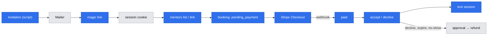
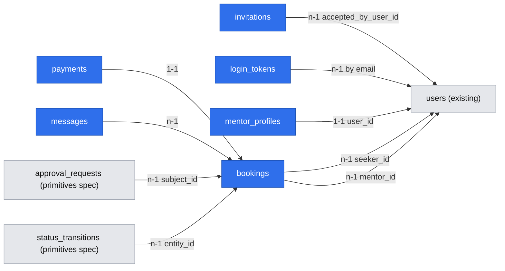

# Pilot booking flow (E01): find a mentor, prepay, hold a 25-minute text session
> ⚠️ Superseded by `.ai/specs/2026-11-15-platform-settings.md` (2026-11-15) — sections: Data Model (booking price policy), API Contracts (POST /api/bookings price calculation), Risks & Impact Review (fixed price constant). Current state: see the new spec.

Screen-map prototype (reference): [`prototypes/konta-i-role/`](../../prototypes/konta-i-role/); screen decisions: [`lekcja-07/mapa-ekranow.md`](../../lekcja-07/mapa-ekranow.md). Related mentor-onboarding prototype (reference only): [`.ai/prototypes/discovery/mentor-onboarding/revision-001/`](../prototypes/discovery/mentor-onboarding/revision-001/).

Status: Ready for implementation, conditional (second pre-implement audit `.ai/analysis/pre-implement-2026-10-26-pilot-specs-2.md`, fixes applied; Phase 1 waits for D24, auto-refund waits for D25). Spec 2 of 2; **depends on** `2026-10-26-pilot-primitives.md` (its Phases 1–4 merge first). Source: issue #7 (E01) with #10–#14; design authority `.ai/specs/product-brief.md`.

## 📝 TLDR

A developer with an urgent blocker needs to find a mentor, see the price, prepay for a 25-minute (25 PLN) or 50-minute (50 PLN) text session; the pilot runs 2026-11-02 to 2026-12-14 with real money and invited participants only. Today the app has e-mail+password auth and an `articles` reference concept, nothing for invitations, mentors, bookings or payments. **Proposed (future behavior):** an invitation-only magic-link sign-in, a mentor list and link, a prepaid booking with attribution, mentor accept/decline with refunds (automatic after a decline or expiry once D25 is recorded, operator-approved otherwise), and a polled text session, all built on the primitives spec.

## 📝 Resolved questions

| Q | Answer (owner, 2026-10-26) | Consequence |
|---|---|---|
| Q1 | Two specs | This is spec 2; primitives are referenced, not redefined |
| Q3 | Magic link | D24 owed from founder A; requires the HTTP `Mailer` adapter |
| Q5 | Port + Stripe adapter + mock | Stripe Checkout adapter lives here; live mode stays off until E03-T02 is recorded |
| Q6 | Mentor proposes the start on accept | `starts_at` set at accept (default now, max +7 days); no availability concept |
| Q9 | Requester change (2026-11-10): seekers should be able to reserve a mentor at a specific available time | Supersedes Q6 for new bookings: mentors publish discrete 25-minute UTC slots up to 7 days ahead; the seeker chooses one before checkout; the slot is atomically held by the booking and becomes unavailable to others; mentor acceptance confirms that time rather than proposing a new one. Existing accepted-booking overlap protection remains a final invariant. |
| Q7 | Polling and e-mail; reading confirmed 2026-10-26 | Session thread and bookings pages poll; mail for magic links and "paid question" |
| Screen-map account model | All accepted pilot invitations grant seeker capability; `role=mentor` adds mentor capability to the same user; operator access remains a separate allowlist (requester, 2026-10-31) | No general RBAC; a combined seeker/mentor account defaults to `/mentor/bookings`, with the seeker list still directly available |
| Scope | Cut to fit the pilot start 2026-11-02; D24, the 24 h response window (superseded below), the unchosen mail vendor (default HTTP API via `fetch`) and the code-fence default approved by the requester 2026-10-26 | See "Scope for 2026-11-02"; D24 itself is still to be recorded by founder A (Phase 1 step 1) |
| Grill 1 | Refunds after a mentor decline or an unanswered booking are **not** held for approval (requester, 2026-10-26) | Auto-approved by the system actor. This **contradicts D17** ("refunds approved by founder A"), so it is only live once founder A records **D25** superseding D17 for these reasons; until then the code fails closed to approval for every reason. Operator-initiated refunds (no-show) still need approval |
| Grill 2 | If the schedule slips, the in-product thread (Phase 5) is cut first | Confirmed cut order; stopgap defined in Risks |
| Grill 3 | The mentor response window is shorter than 24 h | Default 120 minutes, `MENTOR_RESPONSE_WINDOW_MINUTES`; the value is the author's proposal (the requester gave direction, not a number) and is provisional
| Grill 4 | A mentor has at most one accepted session at a time (requester, 2026-10-26) | Overlapping `[starts_at, ends_at)` of accepted bookings per mentor is rejected at accept time and by the database |
| Grill 8 | After a decline or an expiry the mentor loses access to the question (requester, 2026-10-26) | `BookingDto` for the mentor carries `question` only while status is `paid` or `accepted`; the seeker always sees their own |
| Grill 9 | Day-one payments run on Stripe test keys until the owner flips go-live (requester, 2026-10-26) | Explicit switch (below); test-mode payments do not count toward D05/D08 |
| Grill 10 | Founder A personally flips go-live (requester, 2026-10-26) | Only founder A sets `PAYMENTS_LIVE_ENABLED=true` and the live key in the deployment; no one else is granted that access |
| Grill 11 | One full rehearsal in the target environment precedes the flip (requester, 2026-10-26) | Phase 6 below; its record in `.ai/runs/` is the precondition for founder A's decision |
| Grill 12 | Founder A is invited and signs in first so their id can be set as operator before other invitations (requester, 2026-10-26) | Phase 1 step 4 ordering; operator bootstrap in Risks |
| Grill 5 | The seeker's e-mail is shown only after accept (requester, 2026-10-26) | Before accept the mentor sees the seeker's display name and the question; after accept both parties see the other's e-mail (symmetry is the author's default, since the stopgap needs it) |
| Grill 6 | Mentors show an activity indicator (requester, 2026-10-26) | Coarse `activity` bucket from `mentor_profiles.last_active_at`; mentors must be told (include in the mentor interviews due before 2026-11-02, D20) |
| Grill 7 | The return page reconciles with the provider instead of waiting for the webhook (requester, 2026-10-26) | `reconcile-payment` route and `PaymentGateway.getCheckout` |

## 📝 Problem Statement

Seekers lose half a day to about a week on a blocker with nobody to ask (`[INTERVIEW]` in the brief; frequency not established). The pilot's check is the number of people who prepay in four weeks (D05, D08; fewer than 5 triggers stop-or-revise), with source and time to booking recorded (D13). Effort limits from interviews: someone found within five minutes and no account setup (fintech and platform developers); these are measured, not assumed (D08 optional measure).

## 📝 Proposed Solution

Five thin vertical slices that follow the backlog order (#10 → #11 → #12 → #13 → #14), each a mix of `makeCrudRoute` resources, `makeActionRoute` transitions and one webhook, with all lifecycle changes through `transitionStatus`. A booking row is created at checkout start as `pending_payment`; it is invisible to the mentor and uncounted until the payment webhook marks it `paid`, so "failed payment → no booking" holds in every user-visible and metric sense. Refunds go through `ApprovalService`: until D25 is recorded every refund waits for the operator (D17); after it, a decline or an unanswered booking is auto-approved and only operator-initiated refunds wait.

Alternatives: password plus invite code (rejected by Q3); authorize-then-capture (see primitives spec); creating the booking only on webhook (rejected: Stripe metadata cannot carry a 4000-character question); mentor-proposed starts on acceptance (superseded by Q9).

## 📝 Architecture

New concepts: `auth` (invitations, login tokens, extends existing), `mentors`, `bookings`, `payments`, `messages`. Reused primitives: state machine and `transitionStatus`, `makeActionRoute`, `makeWebhookRoute`, `requirePilotMember`/`requireOperator`/`assertParticipant`, `PaymentGateway`, `Mailer`, `Clock`, `ApprovalService`, and the UI set. Every accepted pilot invitation grants seeker capability; an invitation with `role=mentor` adds mentor capability to that same user identity. Operator access remains a separate `OPERATOR_USER_IDS` allowlist, not a general RBAC system. Cross-system effects: Stripe Checkout and webhooks (new external dependency), a mail provider (new, behind the port; default an HTTP API called with `fetch`, vendor replaceable), the register route can be closed by configuration (`PUBLIC_SIGNUP`, open by default in code). Consumers of this spec: E02/E03 (#15–#23) reuse bookings, payments and the status history.

Takeaway: one linear flow; every arrow that changes a status is a `transitionStatus` call; the refund exits share one approval path, except that a decline or expiry is auto-approved once D25 is recorded.

## 📝 Data Model

Conventions as in the primitives spec. Tables from that spec (`status_transitions`, `approval_requests`) are referenced, not repeated.

| Table (concept) | Columns (beyond id, created_at, updated_at) | Constraints / notes |
|---|---|---|
| `invitations` (auth) | `email` (lowercased), `display_name` (set by the invite script, copied to `users.name` on first sign-in, since `users.name` is required), `role` (`seeker`\|`mentor`), `invited_by` (nullable: script), `accepted_by_user_id`, `accepted_at`, `revoked_at` | unique `email`; accepted and unrevoked = pilot member (D19) with seeker capability; `role=mentor` adds mentor capability to the same user, so a mentor can also book as a seeker; operator access remains separately configured |
| `login_tokens` (auth) | `email`, `token_hash` (SHA-256 of 32 random bytes), `expires_at` (15 min), `consumed_at` | unique `token_hash`; only the hash is stored; single use via conditional update |
| `mentor_profiles` (mentors) | `user_id`, `slug`, `headline`, `bio`, `technologies` (space-separated normalized slugs), `public_work_url`, `is_listed`, `last_active_at` (nullable) | unique `user_id`, unique `slug`; no rating fields (N02); the list is a handful of mentors, so the technology filter runs in the service over listed profiles (move to a join table when the list outgrows that) |
| `bookings` (bookings) | `seeker_id`, `mentor_id`, `question` (≤4000, sensitive; shown to the mentor only while the booking is `paid` or `accepted`), `duration_minutes` (25 or 50), `price_minor` (2500 or 5000 grosz, recomputed server-side), `currency`, `status`, `source` (`link`\|`list`), `landed_at`, `starts_at`, `ends_at`, `availability_slot_id` (nullable only for legacy rows) | indexes (`mentor_id`,`status`), `seeker_id`; unique `availability_slot_id` when non-null; **exclusion constraint** on accepted rows: `EXCLUDE USING gist (mentor_id WITH =, tstzrange(starts_at, ends_at) WITH &&) WHERE (status = 'accepted')` (migration runs `CREATE EXTENSION IF NOT EXISTS btree_gist`, its `down()` drops the constraint and leaves the extension). New seeker bookings require a slot and copy its UTC start and duration-based end into the booking in the same transaction that claims it. |
| `mentor_availability_slots` (bookings) | `mentor_id`, `starts_at`, `ends_at`, `status` (`open`\|`reserved`\|`cancelled`), `booking_id` (nullable) | unique (`mentor_id`,`starts_at`); availability windows are 25 or 50 minutes; starts at least 30 minutes ahead and the full window ends no more than 7 days ahead when created; reserved windows point to one booking. Windows are discrete UTC intervals, not recurring rules or calendar sync. |
| `payments` (payments) | `booking_id`, `provider`, `livemode` (bool, from the provider's session), `provider_session_id`, `provider_payment_id`, `amount_minor`, `currency`, `status` | unique `provider_session_id`, unique `booking_id` |
| `messages` (messages) | `booking_id`, `author_id`, `body` (≤2000, sensitive) | index (`booking_id`,`created_at`,`id`) |

Statuses. Booking: `pending_payment → paid → accepted`; exits `payment_failed` (from `pending_payment`), `declined` and `expired` (from `paid`). `accepted` is terminal for the pilot: there is no `completed` or `no_show` status and no automatic settlement of ended sessions; a no-show is handled by the operator (below). Payment: `pending → succeeded | failed`, `succeeded → refund_pending → refunded`. Approval states are in the primitives spec.

Sensitive data: `question` and `body` are free text about people and possibly production code. They are never logged or placed in events, are returned only to booking participants, and are retained until 2026-12-14 plus 30 days (D15; sweep is #20). Tokens are stored hashed; no card data touches the app.

## 📝 API Contracts

All routes are `apiHandler`-wrapped (envelope `{ ok, data | error }`). Mutations need session, `x-requested-with: devmentor` and same-origin, except the webhook (signature). Bodies pass Zod schemas in `core/src/validators/<concept>/`; actor ids come from the session only.

| Method, path | Builder | Auth | Request → response |
|---|---|---|---|
| `POST /api/auth/magic-link/request` | `apiHandler` | none; limited per client+email | `{ email }` → always `200 { sent: true }`; mail only if the e-mail has an accepted, unrevoked invitation (an existing password user without one is not a pilot member) |
| `POST /api/auth/magic-link/consume` | `apiHandler` | none; limited | `{ token }` → session cookie + `{ user }`; every failure is `401 invalid or expired link`; first use by an invitee creates one user identity and emits `auth.user.registered`; an accepted `mentor` invitation grants both seeker and mentor capabilities |
| `GET /api/mentors?technology=&page=` | `makeCrudRoute.list` | pilot member | `Page<MentorCardDto>`, listed mentors only; each card and profile carries `activity`: `within_hour` \| `today` \| `earlier` \| `never`, computed server-side from `last_active_at` and `Clock` (no precise timestamp is exposed). `last_active_at` is touched only by deliberate mentor actions: consuming a magic link, opening a booking, accept, decline, profile update; never by list polling, so a left-open tab does not look like presence |
| `GET /api/mentors/[id]` | `makeCrudRoute.read` | pilot member | `MentorProfileDto` by UUID (the builder's `id` param is a UUID); unknown or non-member → 404. The page `/m/[slug]` resolves a slug with `GET /api/mentors?slug=` (the list query also accepts `slug`; returns at most one profile, listed or not, to a pilot member) |
| `PUT /api/mentors/[id]` | `makeCrudRoute.update` | owner | profile fields, technologies, `isListed` |
| `GET /api/mentors/[id]/availability?from=&to=` | `apiHandler` | pilot member | Open slots for a listed mentor in the next 7 days, ordered by UTC start; no seeker data |
| `POST /api/mentors/me/availability` | `makeActionRoute` | accepted mentor | `{ startsAt, durationMinutes: 25\|50 }` → availability window; start must align to a 15-minute boundary, be at least 30 minutes ahead, and the window must end within 7 days; duplicate/overlapping mentor windows → `409` |
| `DELETE /api/mentors/me/availability/[id]` | `makeActionRoute` | slot owner | Cancels an open slot; a reserved slot cannot be withdrawn, and cancelling one never changes an existing paid booking |
| `POST /api/bookings` | `makeCrudRoute.create` | pilot member | `{ mentorId, availabilitySlotId, durationMinutes: 25\|50, question, source, landedAt }` → `{ booking, checkoutUrl }`; slot claim, booking and payment row are atomic; price recomputed server-side (25/50 PLN); a 50-minute booking requires a 50-minute window; `landedAt` clamped to [now−24 h, now] |
| `GET /api/bookings?role=&page=` | `makeCrudRoute.list` | participant | own bookings with `status`, `refundStatus`, `allowedActions`, `serverTime`, `priceMinor` and `currency` (the price of that booking, what was charged), the mentor's card (`mentor: { id, name, headline, technologies }`, so the seeker's list "My sessions" needs no second request) and, for an accepted booking, `startsAt` (owner decision 2026-10-28); for `role=seeker` the response holds **all** of the seeker's bookings, newest first, because the status filter of "My sessions" runs in the client (owner decision 2026-10-28; `page` is not used for the seeker's list in the pilot); runs lazy settlement — the one sanctioned write on a GET: only idempotent *system* transitions through `transitionStatus` (expiry only), never user data |
| `GET /api/bookings/[id]` | `makeCrudRoute.read` | participant | `BookingDto` (question visible to both parties only; the seeker's `displayName` always, `counterpartEmail` only when status is `accepted`) |
| `POST /api/bookings/[id]/accept` | `makeActionRoute` | the booking's mentor | `{}` → `BookingDto`; confirms the already-selected slot. An overlap with another accepted session of this mentor → `409`; slot remains reserved while the booking awaits acceptance |
| `POST /api/bookings/[id]/decline` | `makeActionRoute` | the booking's mentor | `{}` → `BookingDto`; opens a refund approval, auto-approved when `declined` is in `REFUND_AUTO_APPROVE_REASONS` (D25) |
| `GET /api/bookings/[id]/messages?after=<cursor>` | `apiHandler` | participant | `{ items, cursor, serverTime, session: { status, endsAt } }` |
| `POST /api/bookings/[id]/messages` | `makeActionRoute` (action `post`) | participant | `{ body }` → message; only while `now ∈ [startsAt, endsAt]` and status `accepted`; CSRF and session like every mutation |
| `POST /api/payments/webhook` | `makeWebhookRoute` | provider signature | completed/expired/failed events; idempotent |
| `POST /api/bookings/[id]/reconcile-payment` | `makeActionRoute` | the booking's seeker | `{}` → `BookingDto`; asks the gateway (`getCheckout`) and, if the session is paid, applies the same idempotent transition the webhook would; rate-limited per booking |
| `GET /api/operator/approvals?status=` | `apiHandler` | operator | pending refund requests (operator-initiated, or any reason not auto-approved) with booking summary (no question text) |
| `POST /api/operator/approvals/[id]/approve\|reject` | `makeActionRoute` | operator | executes or cancels the refund |
| `POST /api/operator/bookings/[id]/refund` | `makeActionRoute` | operator | opens a refund request (`operator_initiated`) for a `paid` or `accepted` booking, e.g. a mentor no-show; the same approve step then executes it |

New env (zod, lazy): `PAYMENTS_MODE` (`mock` default | `stripe`), `STRIPE_SECRET_KEY`, `STRIPE_WEBHOOK_SECRET`, `PAYMENTS_LIVE_ENABLED` (default `false`; a `sk_live_` key with the flag unset makes the payment routes fail with a configuration error, lazily, so the app still boots), `MAILER_MODE` (`console` default | `http`), `MAILER_API_KEY`, `MAIL_FROM`, `PUBLIC_SIGNUP` (default `true`, the pilot deployment sets `false`), `APP_BASE_URL`, `MENTOR_RESPONSE_WINDOW_MINUTES` (default 120), `REFUND_AUTO_APPROVE_REASONS` (default empty = every refund needs approval; the pilot sets `mentor_declined,mentor_unresponsive` after D25).

## 📝 UI/UX

Pages: `(auth)/login` (e-mail form), `(auth)/auth/verify` (POSTs the token, strips it from the URL, `Referrer-Policy: no-referrer`), `(marketing)/mentors` (plain technology filter + DataTable, no ratings), `(marketing)/m/[slug]` (profile + available-time selector + booking form), `(student)/bookings` and `/bookings/[id]`, `(mentor)/mentor/bookings`, `/mentor/availability` and `/mentor/profile`, `(operator)/operator/approvals`.

Only what is unique:
- **Screen-map entry and role destinations:** a safe same-origin return path wins when the signed-in user is authorized for it; otherwise an operator lands on `/operator/approvals`, a mentor on `/mentor/bookings`, and a seeker on `/mentors`. A user with both seeker and mentor capabilities defaults to `/mentor/bookings` (owner-approved 2026-10-31); the seeker list remains directly available. These are existing destinations, not new dashboards.
- **Access denial and expired sessions:** unauthenticated protected-page requests go to login with only a same-origin return path; an expired session is identified without exposing protected data. After sign-in, return only if the user still has access, otherwise use their default destination. Authenticated users without access see a neutral denial; resources whose existence is hidden retain 404. Sensitive form content and tokens are never retained in the return path or client storage.
- **Design-system scope:** use existing `Page`, `Card`, `Field`, `Input`, `Button`, `Alert`, `TextLink`, and feedback components; add no shared primitive or login-provider component. Use `Card` on login per the design-system guide; unifying the existing `LoginView` is deferred. Do not add calendar, messages, ratings, coupons, or other unlisted features to the role home pages.
- **Price before the first keystroke (R04):** the price notice renders above the question field; the form cannot show without it.
- **Choose a real time before paying (Q9):** the mentor profile shows open slots in the seeker's local timezone with the timezone named; the seeker selects exactly one. Price and 25-minute duration remain visible before the question. Checkout is unavailable until a slot is selected. The mentor manages slots using existing `Page`, `Field`, `Input`, `Button`, `Alert`, and hairline-separated list patterns; do not add a calendar grid or external calendar integration.
- **Under five minutes to booking:** link → e-mail → inbox → one tap → profile → question → Checkout; no password, no profile form for a seeker.
- **Session thread:** polling every 3 s, countdown from `serverTime`, composer disabled outside the window with the reason stated; read-only after `endsAt`. Text only (N01): no attachments, no video links offered.
- **Code in messages (non-blocking, issue #14):** default plain text with triple-backtick fences in monospace, nothing else rendered. Approved as the default.
- **Mentor sees the question before the accept button (R05).** Declined and expired bookings show "refunded" (or "refund processing" while the gateway call runs) when auto-approved; any booking whose refund waits for the operator shows "refund pending approval".
- **Mentor activity (Grill 6):** cards and the profile show a short label ("Active within the hour", "Active today", "Active earlier", "Not active yet") above the price, with the line "Not a promise of reply time"; the label never replaces the price notice.
- States: loading/empty/error via `feedback/*` everywhere; new messages announced with `aria-live="polite"`.

## 📝 Edge Cases & Failure Scenarios

| Scenario | Behavior |
|---|---|
| Uninvited e-mail asks for a link | Same `200`, no mail, no enumeration |
| Link opened twice, expired, or prefetched by a mail scanner | GET never consumes; POST consumes once; otherwise generic 401 with a "request a new link" path |
| Checkout abandoned or card declined | `pending_payment` → `payment_failed` (on the provider's expired/failed event, or when settlement finds it unpaid after the session expiry); never visible to the mentor, never counted. A retry creates a **new** booking row (the form pre-fills the question); there is no edge back out of `payment_failed` |
| Webhook delivered twice or out of order | Conditional transition makes the replay a no-op; `amount_total` ≠ `price_minor` → not marked paid, logged, shown to the operator |
| Webhook never arrives | The return page polls for 60 s, then calls `reconcile-payment` once and every 30 s after, so the booking becomes `paid` without the webhook; the same path (`PaymentService.handleEvent`) runs, so a late webhook is a no-op; settlement also reconciles `pending_payment` bookings older than 15 min |
| Accept and decline race, or accept after expiry | One wins in the database; the other gets `409` with the current status |
| Two seekers choose the same slot concurrently | A row lock/conditional claim allows exactly one booking and checkout; the other receives `409` and refreshes availability. Slot claim and booking/payment-row creation share one transaction; checkout-provider failure marks payment failed and releases the slot. |
| Mentor accepts two bookings with overlapping times, also concurrently | The exclusion constraint rejects the second even when both requests pass the application check; `ConflictError`; because the selected slot was already reserved, this indicates stale/corrupt data and is surfaced to the operator |
| Mentor tries to cancel a reserved slot | `409`; the mentor declines the booking through the existing flow, which starts the configured refund path and releases the slot only after the booking leaves `paid` |
| Mentor withdraws an open slot after a seeker loaded the profile | Selection is checked and claimed server-side; stale client choice gets `409`, no payment is created |
| Booking payment fails or expires | The associated reserved slot returns to `open` after the booking transitions out of `pending_payment`; settlement/reconcile paths perform the same idempotent release |
| Seeker's name or e-mail before accept | Mentor sees the display name only; the e-mail appears in the DTO only after accept (test: DTO of a `paid` booking has no e-mail field) |
| Mentor never answers | After `MENTOR_RESPONSE_WINDOW_MINUTES` (120, ⚠ provisional, ties to A02 and the 60-minute reply criterion in D08) lazy settlement → `expired` + refund request, auto-approved under D25 |
| Mentor does not appear | The seeker reports it (e-mail to the operator, linked from the session page) or the operator sees it; the operator opens a refund with `operator_initiated` and approves it the same day (R04, D17). No automatic detection in the pilot |
| Refund approved (by the operator or auto) but gateway fails | Approval stays `approved`, payment `refund_pending`; the next settlement pass or the operator retries; idempotency key = approval id, so no double refund |
| Non-participant opens a booking or session | `404` for an existing id that is not theirs; fail closed on any lookup error |
| No worker for due transitions | Settlement runs on reads and on the operator list, and `npm run bookings:settle` is cron-ready; staleness delays a transition, never corrupts payment state |
| Clock skew | The page shows the end time from `serverTime`; posting is checked on the server clock only |
| Mail provider down | Magic link: still `200`, failure logged, seeker retries (rate-limited); paid-question mail: logged, the mentor's bookings page shows it anyway |
| Seeker lands, returns days later | `landed_at` clamp bounds the time-to-booking measure |

## 📝 Risks & Impact Review

- **Hard to reverse:** Stripe and mail dependencies, the booking/payment status vocabulary, availability-slot migrations and slot lifecycle once real payments exist. Price is a constant (a change is a deploy; acceptable per D16).
- **Scope change Q9 (requester, 2026-11-10):** choosing a time introduces mentor-managed slots and a new concurrency boundary. The implementation must atomically claim slots with booking creation, release them idempotently on failed/expired payment or mentor decline, and keep the overlap exclusion constraint. It does not add recurring calendars, external calendar sync, timezone-specific storage, or rescheduling.
- **D17 supersession (needs founder A):** the requester chose auto-refund after a decline or an unanswered booking, which D17 ('refunds approved by founder A') does not allow. D25, to be written by founder A, narrows D17 to operator-initiated refunds. Until D25 exists the default `REFUND_AUTO_APPROVE_REASONS` is empty and every refund waits for the operator; the feature is code-complete either way. The 120-minute window is an unsourced default.
- **Budget and schedule:** the brief sets 25 hours before refunds, previews, the list and payouts were added, and says the fit was not checked. After the cut below, the plan is smaller but **still not shown to fit** seven days; the day plan is a hypothesis. If it slips, cut in this order: (1) the in-product thread, Phase 5 — only with the owner's explicit call, because it stretches N01's intent (exchange moved off-platform); (2) the technology filter; (3) the paid-question e-mail (mentors then rely on the bookings page). Do not cut Phase 4: real money needs an exit.
- **Stopgap if Phase 5 is cut (confirmed cut order):** after accept, the booking page and the accepted-mail show the other party's e-mail address and the agreed start, and the exchange happens off-platform; #14 is deferred. That stays text only (N01's "no video" holds) but breaks #14's "cannot be moved to another channel" and exposes participants' e-mails to each other; both invited, but the owner should know.
- **Code-ready is not payment-ready:** being able to take a payment on 2026-11-02 does not permit it. The first real payment still waits for D24, D25, the verifier's review (E03-T02) and the terms acceptance (E03-S01); until then `PAYMENTS_MODE=stripe` runs on `sk_test_` keys, a `sk_live_` key is refused unless `PAYMENTS_LIVE_ENABLED=true`, and the checkout page shows a visible test-mode banner. Going live is one deliberate configuration change made by founder A personally (Grill 10) and recorded in `.ai/runs/`, and only after the rehearsal record of Phase 6 exists (Grill 11). **Consequence for the metric:** test payments are not prepayments, so the A03 clock (fewer than 5 prepaid in 4 weeks) cannot start until live mode; and D12 names "the pilot uses test money only" as a review trigger, so founder A should note the gap between 2026-11-02 and the flip.
- **Booking vs payment state:** booking statuses end at `declined`, `expired` or `accepted`; whether the money came back is the payment's status, and `BookingDto` carries `refundStatus` (`none`\|`pending_approval`\|`processing`\|`refunded`) derived from it, which is what the UI shows: `pending_approval` waits for the operator, `processing` is approved and the gateway call is running, `refunded` is done (owner decision 2026-10-28, the same four values as `RefundState` in the UI).
- **Seeker time zone:** dates shown to a seeker use the `timeZone` of the seeker's profile, an IANA name (owner decision 2026-10-28). This spec has no seeker profile yet, and where its first value comes from is open.
- **Existing behavior:** `/api/auth/register` is a protected route (BC surface 2). The code default stays `PUBLIC_SIGNUP=true`, so nothing changes for existing deployments; the pilot deployment sets `false` (D15: no public sign-up), which makes `register` answer a refusal there only. Password login stays for existing users.
- **Real money:** live mode stays off until the verifier's review (E03-T02) is recorded; going live is a `sk_live_` key plus a note in `.ai/runs/`. The Stripe adapter is verified against the mock contract tests and Stripe test mode only.
- **Operator bootstrap (Grill 12, confirmed):** `OPERATOR_USER_IDS` needs founder A's user id, available only after first sign-in. Fixed order: invite founder A first, they sign in, `pilot:invite --list` prints the id, it goes into the deployment variable, and only then are the other participants invited. Until the variable is set nobody is an operator (fail closed), so refunds that need approval would wait.
- **Abuse:** magic-link endpoints use the in-memory limiter (resets on restart, not shared); acceptable for an invited pilot.
- **Next.js:** read `node_modules/next/dist/docs/` before pages, the webhook raw body and any work deferred after a response, as `AGENTS.md` instructs.

## 📝 Decisions in play

Relied on: D04, D05/D08/D13, D15, D16, D17, D19, R01, R04, R05, N01, N02 (R02, D06, D09, D11, D14, D18 only as reuse targets). Proposed new records: **D25 — decline and expiry refunds are automatic; D17's approval applies to operator-initiated refunds only** (owner founder A; supersedes part of D17; required before `REFUND_AUTO_APPROVE_REASONS` is set); **D24 — pilot sign-in is an e-mail magic link from an invitation** (owner founder A; fills the "login method not decided" gap in D12/D15; completes #10; supersedes nothing). D25 would supersede part of D17; the code fails closed to D17 until D25 exists, and founder A owns both records. Nothing else here contradicts an active decision.

## 📋 Traceability (issue acceptance criteria → step → oracle)

| Issue AC | Step | Oracle |
|---|---|---|
| #11 invited seeker sees only invited mentors + technology filter | 2.2, 2.3 | service test: filter and listed-only; page E2E |
| #11 a mentor's link shows the profile | 2.2, 2.3 | `GET /api/mentors?slug=` returns the profile for a member |
| #11 non-invited sees no mentors (D19) | 2.2 | non-member → empty/404 on list and read |
| #11 no ratings (N02) | 2.2 | DTO type has no rating fields; snapshot test of the DTO keys |
| #12 price visible before writing | 3.5 | component test: price notice precedes the question field |
| #12 payment through Stripe, booking recorded as paid (also when the webhook is lost) | 3.3, 3.4, 3.5 | webhook test → one `paid` transition; adapter contract tests |
| #12 landing→payment time and source recorded | 3.2, 3.3 | `status_transitions` row plus `source`/`landed_at` columns |
| #12 failed payment → no booking | 3.2, 3.3 | `payment_failed` booking never listed for the mentor |
| #12 duration and price | 3.2, 3.3 | seeker can select 25 minutes (25 PLN) or 50 minutes (50 PLN); server ignores client price, rejects an unavailable window, and stores/charges the selected duration and price |
| #13 mentor sees the question before accepting (R05) | 4.1 | mentor booking DTO contains the question while `paid` |
| #13 seeker receives confirmation of the time | 4.1 | mail subscriber test on accept |
| Grill 8 mentor loses the question after decline or expiry | 4.1 | DTO test per status for the mentor and the seeker |
| Grill 11 rehearsal precedes go-live | 6 | the rehearsal record exists in `.ai/runs/` with every check passed |
| Grill 9 live keys refused without the flag; test payments not counted | 3.4 | config test; the pilot-count query (E03-S03) filters `livemode = true` |
| Grill 6 activity shown as a bucket, no precise time | 2.2 | DTO test: only the four values; list polling does not touch `last_active_at` |
| Grill 4 one accepted session per mentor | 4.1 | integration test: two overlapping accepts, sequential and concurrent → one succeeds, one `409` |
| Grill 5 e-mail only after accept | 4.1 | DTO test before and after accept |
| #13 no-show → refund same day (R04, D17) | 4.2 | operator-initiated refund route + approve; manual, not automatic |
| #13 decline → refund | 4.2, 4.3 | decline opens an approval that is auto-approved when configured (D25), otherwise waits; refunds exactly once either way |
| #13 unanswered booking → refund | 4.2 | expiry after the window, auto-approved when configured |
| #14 text exchange for 25 minutes (R01, N01) | 5.1, 5.2 | post allowed inside the window only |
| #14 non-participant sees nothing | 5.1 | 404 test |
| #14 session ends after its selected duration | 5.1, 5.2 | post after `ends_at` rejected; page read-only |
| #10 decision record and brief names the method | 1.1 | D24 file exists, brief line updated |
| #10 / s01 invitation-only magic-link request | 1.1, 1.3, 1.4 | invited and uninvited valid addresses receive the same `200 { sent: true }` response; only an accepted, unrevoked invitation causes mail; UI tests cover invalid email, loading, neutral confirmation, rate limit and generic request failure without account enumeration. Mail transport failure is logged and remains indistinguishable from success |
| #10 / s01 registration and login-provider scope | 1.3, 1.4 | pilot deployment has `PUBLIC_SIGNUP=false`; no public registration, password or GitHub flow is offered to pilot invitees; the first successful use of a valid invitation link creates one account; existing password behavior for non-pilot users is unchanged |
| #10 / s04 magic-link verification | 1.2, 1.3, 1.4 | UI tests cover loading and generic server-error states; valid token succeeds once and expires after 15 minutes; expired/reused tokens return the generic 401 with a request-new-link path; success redirects immediately, without a success screen; the token is removed from the URL |
| #10 / s04 and s08 safe return after sign-in | 1.2, 1.4 | same-origin return path is preserved only while still authorized; external, malformed or newly unauthorized destinations fall back to the user's default page; tokens and sensitive form content never enter the return path or client storage |
| #10 / s01 account conflicts | 1.2, 1.3 | an existing account without a valid pilot invitation receives the same request response; no automatic account or sign-in-method linking occurs |
| #10 / s05 and s06 combined seeker/mentor capability | 1.2, 1.4, 2.3 | the product calls the seeker capability “seeker” (not “mentee”); a single accepted mentor invitation yields one `user.id` that can use both seeker and mentor flows; default destination is `/mentor/bookings`; a seeker-only invitation defaults to `/mentors`; an operator's allowlist entry is required for operator access; operator destination takes precedence |
| #10 / s05 seeker home | 2.2, 2.3 | seeker-only login defaults to the invited-mentor list; list responses include listed mentors only; loading, empty and error states have UI/service tests |
| #10 / s06 mentor home | 2.3, 4.1 | mentor login defaults to that mentor's bookings; loading, empty and error states have UI tests; the list and actions expose only bookings belonging to that mentor |
| #10 / s07 operator home | 1.4, 4.3 | allowlisted operator login defaults to approvals; loading, empty and error states have UI tests; a non-operator cannot read or act on the approval queue |
| #10 / s08 access denial | 1.3, 1.4, 2.2, 4.1, 4.3 | unauthenticated requests go to s01; expired-session notice offers sign-in; authenticated denial is neutral and links to the user's permitted home; protected hidden resources preserve 404; after sign-in, access is rechecked before return and unauthorized destinations fall back to the user's home |

## 📋 Phasing

1. #10 — invitation and magic-link sign-in.
2. #11 — mentors list and links.
3. #12 — question, price, prepayment, attribution.
4. #13 — accept, decline, approvals, refunds.
5. #14 — text session.

Each phase leaves the app working, but they are not equally independent: 1 and 2 stand alone; 3 needs 1–2; 4 needs 3 (and must ship before any real payment, see Risks); 5 needs 4 and adds only the thread; `accepted` stays terminal. Prerequisite: primitives spec Phases 1–4 (Phase 1 here needs primitives Phases 2–3; the UI steps need Phase 4). Q3 (magic link) is relied on as decided; D24 must be recorded in Phase 1 step 1 before its code merges.

## 📋 Implementation Plan

Validation after each step: `npm run type-check && npm run lint && npm test && npm run build`. "T:" is the test that must fail without the step.

### Phase 1 — Sign-in (#10)
1. D24 decision record from founder A and a one-line brief update (acceptance of #10).
2. `invitations`, `login_tokens` entities + migrations; `InvitationService`, `MagicLinkService` (hash, TTL, single-use conditional update); env additions; `requirePilotMember` resolver wired to invitations.
3. Routes `magic-link/request` and `/consume`, limiter per client+email; `PUBLIC_SIGNUP` guard on `register`. T: invited and uninvited requests return identical responses; reused token → 401.
4. Pages `login`, `auth/verify`; HTTP `Mailer` adapter; `pilot:invite` script (`--email --name --role`, `--list`) in `packages/core/scripts/` (it uses core services, and `db` must not import `core`), run with `ts-node` as in `db`'s seed script (`ts-node` added to `core` devDependencies), root script `npm run pilot:invite`. `.env.example` and `README.md` gain the new variables. The operator bootstrap order of Risks is part of the script's `--help` text. E2E: invite → link → signed in.

### Phase 2 — Find a mentor (#11)
1. `mentor_profiles` migration, repository, `MentorService` (technology filter in the service).
2. Routes via `makeCrudRoute`; DTOs without any rating field. T: non-member gets nothing; unlisted mentor absent from the list but reachable by link; an uninvited mentor cannot exist (D19).
3. Pages `mentors`, `m/[slug]`, `mentor/profile` with a plain `<select>` filter and `DataTable`; capture `source` for Phase 3.

### Phase 3 — Question, price, prepay (#12)
1. `bookings`, `payments` + migrations; booking and payment state machines.
2. `BookingService.create` (price recomputed, `landedAt` clamped, payment + checkout). T: client-sent price ignored; failed payment leaves no `paid` booking.
3. Payment webhook route and `PaymentService.handleEvent` via `transitionStatus` (amount check, replay no-op). T: replay → one `paid` transition; amount mismatch → not paid.
4. Stripe Checkout adapter (test mode; the adapter reports `livemode` from the session) passing the port's contract tests; `PAYMENTS_MODE` wiring in `container.ts`.
5. `reconcile-payment` route (`makeActionRoute`, calls `PaymentGateway.getCheckout`, same handler as the webhook). Pages: booking form (price above the field), return page that polls 60 s and then reconciles. T: reconcile before and after the webhook yields one `paid` transition; unpaid session stays `pending_payment`. E2E: mock payment → booking `paid`.

### Phase 4 — Accept, decline, refund (#13)
1. Migration adding the accepted-booking overlap constraint and availability-slot constraints (with `btree_gist`); `accept` confirms the reserved seeker-selected time, `decline` releases the slot through the database lifecycle trigger; mentor bookings page shows the question and requested time first; mail for "new paid question" and "accepted".
2. Decline and expiry open refund approvals (gated by D25 for the auto-approve list;`ApprovalService` auto-approves reasons listed in `REFUND_AUTO_APPROVE_REASONS` with the system actor and runs the refund in the same request); lazy expiry settlement (read-triggered, idempotent) and `bookings:settle`; operator-initiated refund route. T: concurrent accept/decline; an unanswered `paid` booking expires only after the window.
3. Refund execution via `PaymentGateway.refund` (key = approval id) with retry; operator approvals page; `refundStatus` in the DTO. T: gateway failure then retry refunds exactly once.

### Phase 5 — Text session (#14)
1. `messages` entity + migration; `MessageService` (server-clock window, participant check, cursor read).
2. Routes and page with `usePolling` and a plain end-time label; read-only after end. T: non-participant gets 404; post outside the window rejected; session ends at 25 minutes.

### Phase 6 — Rehearsal before go-live (precondition, not code)
1. In the target environment with Stripe **test** keys and a real mail provider: invite a seeker and a mentor, magic-link sign-in for both, mentor activity label visible, booking, test payment (also once with the webhook blocked to exercise `reconcile-payment`), accept with an overlap rejected, decline path with the automatic refund (only if D25 is recorded; otherwise approve it as operator), operator-initiated refund, expiry after the window, and the question hidden from the mentor after decline.
2. Record each check with its result in `.ai/runs/2026-11-xx-pilot-rehearsal.md` (what ran, evidence, failures). Any failure blocks the go-live decision until fixed and re-run.
3. Founder A reads the record and decides on go-live, together with D24, D25, E03-T02 and E03-S01 being in place. This step produces no code and is not counted in the phases' shippability.

### Cross-cutting rules for every phase

- Each new event (`auth.invitation.created`, `bookings.booking.created|paid|accepted|declined|expired`, `payments.payment.succeeded|failed|refunded`, `approvals.approval.requested|approved|rejected`, `messages.message.posted`) is added to `EventMap` and `logging-subscriber.ts` in the step that first emits it; payloads carry ids only.
- New npm scripts (`pilot:invite`, `bookings:settle`) are additive to BC surface 7; they are not used by CI.
- Every migration has a hand-checked `down()`; CI's `migrate`, `migrate:down`, `migrate` sequence must stay green; each PR body states the rollback plan and carries `risk-high` for Phases 3–4.
- New `core` exports are registered in `core/src/server.ts`; the new route files are `force-dynamic` like the existing ones.

### Day plan (hypothesis, 2026-10-27 to 2026-11-01; launch day 2026-11-02)

| Day | Work |
|---|---|
| 10-27 | Primitives Phases 1–3 (state machine, `transitionStatus`, route builders, ports, approvals) |
| 10-28 | Primitives Phase 4 (`usePolling`, `StatusBadge`, `ActionButton`); E01 Phase 1 (invitations, magic link, Mailer, `pilot:invite`) |
| 10-29 | E01 Phase 2 (mentors) and Phase 3 steps 1–2 (bookings, payments, create) |
| 10-30 | Phase 3 steps 3–5 (webhook, Stripe adapter, pages) |
| 10-31 | Phase 4 (accept/decline, refunds, operator pages, expiry) |
| 11-01 | E2E and the Phase 6 rehearsal; Phase 5 (thread) only if every other phase is done and green, otherwise it ships after launch with the stopgap |

### Gate summary (what blocks what)

| Gate | Blocks |
|---|---|
| D24 recorded (founder A) | Phase 1 code merge |
| D25 recorded (founder A) | setting `REFUND_AUTO_APPROVE_REASONS` in the deployment (code can merge) |
| `OPERATOR_USER_IDS` set after founder A's first sign-in | any approval-gated refund; invitations of other participants |
| Phase 6 rehearsal record, D24, D25, E03-T02, E03-S01 | founder A's go-live flip (`sk_live_` + `PAYMENTS_LIVE_ENABLED=true`) |
| Mentor interviews (D20) mention the activity label | showing the label to seekers |

### Screen-map decisions without acceptance criteria

| Screen | Recorded decision |
|---|---|
| s02 | No public registration screen or flow in the pilot. The account is created on first successful use of an invitation link; `PUBLIC_SIGNUP=false` in the pilot deployment. |
| s03 | No separate registration-verification or success screen. Link-sent feedback is part of s01; successful verification redirects from s04. |

No separate design-system component is added for excluded GitHub/password providers or registration. The s01 login uses the existing `Card` composition; unifying the existing `LoginView` is deferred. The s07 and s08 compositions use existing components locally; no shared operator-page or access-denied primitive is added. No account linking is done automatically; login responses must not reveal whether an address has an account or invitation.

The grey prototype's sample availability slots are no longer merely illustrative: requester decision Q9 (2026-11-10) adopts discrete mentor-published slots for seeker booking. Slot validation and lifecycle are specified above; recurring availability and external calendar sync remain out of scope.

### Research questions to validate (not acceptance criteria)

The synthetic walkthroughs are hypotheses for follow-up with invited mentors, not evidence of a barrier and not product requirements:

- **E01 / mentor profile:** Can invited mentors omit the public-work link, and who do they understand can see it? Does the invitation explain the later setup steps, and can a mentor resume setup after deferring or return from the profile step?
- **E01 / mentor profile:** Can mentors inspect a profile before completing all required fields? Does the grey prototype communicate the slot selector clearly?
- **E01 / keyboard access:** Is focus and keyboard navigation through the invitation and profile steps clear to invited mentors? The walkthrough observed a focus outline but did not test keyboard behavior.

Sources: [walkthrough session 001](research/walkthroughs/2026-10-31-mentor-onboarding-session-001/report.md) and [walkthrough session 002](research/walkthroughs/2026-10-31-mentor-onboarding-session-002/report.md). No prototype-feedback export was available for this review.

### Close-out
Update the primitives catalogue with anything learned, lesson entry for non-obvious findings, and move both specs to `.ai/specs/implemented/` after Phase 5 merges.
