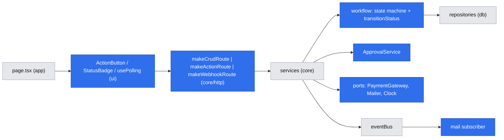
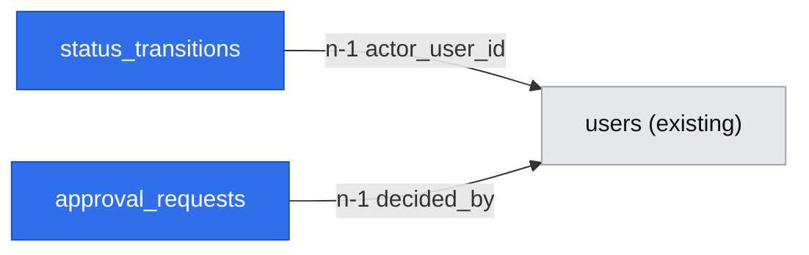

# Pilot primitives: workflow, ports, approval and UI building blocks

Status: Ready for implementation (requester approved 2026-10-26 after the pre-implement audit `.ai/analysis/pre-implement-2026-10-26-pilot-specs.md`; fixes applied, not re-audited). Spec 1 of 2. Its first consumer is `2026-10-26-pilot-booking-flow.md` (issue #7, E01); the backlog is `.ai/specs/backlog.md`, design authority `.ai/specs/product-brief.md`.

## 📝 TLDR

The pilot backlog (E01–E03, issues #7–#23) repeats a handful of kinds of functionality: actions on a resource, lifecycles with transitions, money behind a vendor, human approval, consent, pilot-only visibility, time-boxed interaction. Today the app only has CRUD primitives (`makeCrudRoute`, `CrudForm`, `DataTable`). **Proposed (future behavior):** add the backend and frontend primitives below, each proven by a named consumer in the E01 spec, so E02 and E03 become configuration over them instead of new patterns. This spec changes no user-visible behavior.

## 📝 Resolved questions

| Q | Answer (owner, 2026-10-26) | Consequence |
|---|---|---|
| Q1 | **Two specs** (revised from "one") | This spec = primitives; `2026-10-26-pilot-booking-flow.md` = E01 on top. Primitives ship first and are only merged with a consumer lined up |
| Q2 | Build only what E01 consumes | Approval gate is built (refunds need founder A's approval, D17); `AnswerGenerator` port, ledger/payout, retention sweep stay contract-only |
| Q4 | `OPERATOR_USER_IDS` env list | One `requireOperator` helper, no roles |
| Q5 | Port + Stripe adapter + mock | Port and mock live here; the Stripe adapter ships with its flow in the E01 spec |
| Q7 | "tak": polling **and** e-mail; reading confirmed 2026-10-26 | `usePolling` and a `Mailer` port are primitives |
| Scope | Cut to fit the pilot start 2026-11-02; remaining flagged items approved by the requester 2026-10-26 | See "Scope for 2026-11-02"; deferred primitives move to "Deferred" below and are not built now |

(Q3 magic link and Q6 mentor-proposed start belong to the E01 spec.)

## 📝 Scope for 2026-11-02

Seven days remain (today 2026-10-26). Only primitives on the critical path to a prepaid booking with an exit (refund) are built now. **Deferred** (designed, no code until their consumer is scheduled): `ConsentService` and `consents` (terms at payment is E03-S01, gated by the verifier's review anyway), `Countdown`, `FilterBar` + `useUrlState` (the pilot list has a handful of mentors: one plain filter, no URL state), `CrudForm` checkbox/select/description, the shadcn additions (`dialog`, `badge`, `select`, `checkbox`: `StatusBadge` is a styled ``, `ActionButton` confirms with the browser's own `confirm()`), and the mentor/seeker `ApproverResolver`s. The estimate that the rest fits in seven days is not verified; the next cuts, in order, are in the E01 spec.

## 📝 Problem Statement

Each story that re-invents access, money, lifecycle or consent logic multiplies the cost of the pilot's own decisions changing (prices D16, share D11, preview window D18, thresholds D08), and the pilot's pass/fail signal (prepaid bookings, source, time to booking, reply time: D05, D08, D13) must be countable without re-instrumenting each feature. The standards already warn that ~9 concepts added one at a time drift apart (`engineering-standards.md`, "Reusable API & UI Layer").

### Kinds of functionality in the backlog

| Kind | Stories | Existing | Gap → primitive (layer) |
|---|---|---|---|
| Owned resource CRUD | profile, question | `makeCrudRoute`, `assertOwns`, `CrudForm`, `DataTable` | none; reuse |
| Action on a resource (`accept`, `decline`, `approve`) | #13, #16, refunds | CRUD verbs only | `makeActionRoute` (core/http) + `ActionButton` (ui) |
| Pilot visibility gate | #11, #22 (D19) | none | `requirePilotMember` (core) fed by invitations (E01 spec) |
| Lifecycle with transitions | booking, payment, approval, vault answer | ad hoc | `defineStateMachine` + `transitionStatus` (core + db) + `StatusBadge` (ui) |
| Audit and measurement | reply time, time to pay, prepaid count (#23) | event bus logs only | `status_transitions`, written in the same transaction |
| Money in/out | #12, #13, #17, #22 | none | `PaymentGateway` port, price constants, `makeWebhookRoute` |
| Human approval | refund (D17), mentor preview (D09), seeker approval (R02) | none | `approval_requests` + `ApprovalService` |
| Consent, versioned | #21, #22, #15 | none | `consents` — **deferred** |
| Participant-scoped content | #14 | `assertOwns` (one owner) | `assertParticipant` |
| Time-boxed interaction, no workers | #14, previews until 2026-12-14 | none | `Clock` port; `usePolling` (ui); `Countdown` deferred |
| Notifications | #13 | none | `Mailer` port + event subscriber |
| Filtered lists | #11, operator lists | `DataTable` | `FilterBar` + `useUrlState` (ui) — **deferred** |

Reused unchanged: `apiHandler`, `makeCrudRoute` (mutations always session + CSRF), `requireSession`, `assertOwns`, rate limiter, typed `eventBus`/`EventMap`, `withScope` with manual Awilix registration, `defineDomainEntity`, repositories over an `EntityManager`, DTOs in `core`, shared Zod schemas, `apiCall`, `DataTable`, `feedback/*`.

## 📝 Proposed Solution

Keep the four packages and "no module runtime". A primitive exists only if the table shows a repeated kind **and** the E01 spec consumes it. Server-generic code goes where the standards put it (`core/src/http`, `services/<concept>/*.port.ts`), non-HTTP workflow code in a new `core/src/workflow/`, client-generic code in `ui/src/backend/<category>/` and `ui/src/hooks/`.

Alternatives considered:
- **Stripe authorize-then-capture** (capture on accept, void on decline): simpler for the seeker, but contradicts E01-S02 ("recorded as paid"), D17 and the A03 count of *prepaid* bookings; a candidate for a later superseding decision, not a default. The port keeps both options open.
- **A rules/workflow engine**: rejected (YAGNI; standards forbid auto-discovery). The state machine is a plain typed object.
- **WebSockets/SSE**: rejected for the pilot (no workers, serverless-style hosting); cursor polling.
- **Roles**: rejected by the standards and Q4.
- Market reference (from general knowledge, not freshly verified): Cal.com models bookings as an explicit status enum with a "requires confirmation" step and Stripe payment via webhook; the same shape as accept/decline here. We copy the idea, not its module system.

## 📝 Architecture

Takeaway: features enter through one of three route builders, change lifecycle state only through the transition runner (one transaction: conditional update + history row), and reach the outside only through a port. Consumers: E01 now; E02/E03 planned (table below).

### Consumers (every primitive below has an E01 step that uses it)

Steps refer to the plan of `2026-10-26-pilot-booking-flow.md`.

| Primitive | E01 consumer |
|---|---|
| `defineStateMachine`, `transitionStatus`, `status_transitions` | booking and payment lifecycles (3.1, 3.3, 4.1, 4.2) |
| `makeActionRoute`, `ActionButton`, `StatusBadge` | accept/decline (4.1), operator approve/reject (4.3) |
| `makeWebhookRoute`, `PaymentGateway` | payment webhook and checkout (3.2–3.4) |
| `Mailer`, mail subscriber, `Clock` | magic link (1.2, 1.4), paid-question mail (4.1), pending-booking and response-window settlement (3.3, 4.2), message window (5.1) |
| `ApprovalService` | refund after decline, expiry, no-show (4.2, 4.3) |
| `requirePilotMember`, `assertParticipant`, `requireOperator` | mentors (2.2), bookings and messages (3.2, 5.1), operator pages (4.3) |
| `usePolling` | return page, mentor bookings page, session thread (3.5, 4.1, 5.2) |

Items with only a later consumer are not built here: the mentor/seeker `ApproverResolver`s, `AnswerGenerator`, ledger/payout and retention sweep (see "Reuse by E02/E03").

### Layering of the transition runner

`defineStateMachine` is pure and lives in `core/src/workflow`. The atomic write cannot live in `core` (only `db` imports `@mikro-orm/*`), so `db` exports `transitionStatus(em, { entityType, entityId, from, to, actor, patch? })` as a repository function; `patch` carries the other columns that must change in the same conditional `UPDATE` (e.g. `starts_at`/`ends_at` on accept, `provider_payment_id` on payment success, `decided_by`/`decided_at` on an approval), so database constraints that depend on them (the booking overlap constraint) are evaluated atomically with the status change; a `core` service first asks the machine whether the action is allowed for the actor, then calls the repository function it receives through the container. The machine never imports `db`; `db` never imports the machine.

### Backend primitives (`core` unless noted)

| Primitive | Place | Contract |
|---|---|---|
| `defineStateMachine` | `workflow/state-machine.ts` | `{ states, transitions: { accept: { from: ['paid'], to: 'accepted', actors: ['mentor'] } } }`; pure; `can(status, action, actor)`, `allowedActions(status, actor)`. Servers put `allowedActions` in DTOs so the UI never re-implements policy |
| `transitionStatus` | `db/repositories/transition.ts` | `UPDATE … SET status=to, <patch> WHERE id=? AND status IN (from)` and an insert into `status_transitions`, one transaction; 0 rows → `ConflictError`. Atomic, replay-safe, race-safe; the only way a lifecycle column changes |
| `makeActionRoute` | `http/makeActionRoute.ts` | `POST /api/<concept>/[id]/<action>`: CSRF → session → id + body validation → `withScope` handler; same order and guarantees as `makeCrudRoute` mutations; no `try/catch` |
| `makeWebhookRoute` | `http/makeWebhookRoute.ts` | raw body → port-supplied `verify(rawBody, headers)` → handler. No session, no CSRF: an explicit, documented exemption replaced by signature check; bad signature → generic 400 |
| `requirePilotMember`, `requireOperator`, `assertParticipant` | `http/auth.ts` | Fail closed. Operator = `session.userId ∈ OPERATOR_USER_IDS`. `assertParticipant(session, ids[])` extends `assertOwns`. `requirePilotMember` takes a resolver supplied by the E01 spec |
| `PaymentGateway` port (+ mock adapter) | `services/payments/payment-gateway.port.ts`, `adapters/mock-payment-gateway.ts` | `createCheckout({ bookingId, amountMinor, currency, idempotencyKey }) → { providerSessionId, url }`; `refund({ providerPaymentId, amountMinor, idempotencyKey })`; `parseWebhook(raw, headers) → NormalizedPaymentEvent`; `getCheckout(providerSessionId) → NormalizedPaymentEvent | null` (asks the provider for the session's current state, used to reconcile a lost webhook). Payout/transfer is declared in the spec for E03 only |
| `Mailer` port (+ console adapter) | `services/notifications/mailer.port.ts` | `send({ to, template, data })`; console adapter prints the link in dev; failures are logged, never thrown into a mutation |
| `Clock` | `utils/clock.ts`; `clock` in `Cradle` | `now(): Date`; the only source of time in services; tests inject a fixed one |
| `ApprovalService` | `services/approvals/approval.service.ts` | `request(kind, subject, reason)`, `decide(actor, id, approve\|reject)` through `transitionStatus`; an `ApproverResolver` per kind (refund → operator now; vault answer → cited mentors, session note → seeker later) |
| Money helpers | `constants/pricing.ts` | `SESSION_25_PRICE_MINOR = 2500`, `CURRENCY = 'EUR'`, `SESSION_MINUTES = 25`; the server always recomputes price (D16, money-correctness rule); 50 minutes is not offered |
| Mail subscriber | `events/mail-subscriber.ts` | event → `Mailer`; exceptions logged and swallowed per the existing bus contract |

### Frontend primitives (`ui/src/backend`, `ui/src/hooks`; `ui` stays independent of `core`)

| Primitive | Place | Contract |
|---|---|---|
| `ActionButton` | `backend/actions/` | `{ label, run: () => Promise<ApiResult>, confirm?: string, onDone }`; loading, error line, optional `window.confirm` text; rendered from the DTO's `allowedActions` |
| `StatusBadge` | `backend/status/` | `{ status, labels: Record<string, { text, tone }> }`; each concept supplies its label map in `components/<concept>/`; always text, never color alone |
| `usePolling` | `hooks/` | `{ fetcher, intervalMs, cursor }`; pauses when the tab is hidden, backs off on error, stops on a terminal flag; server returns `serverTime` |

### Reuse by E02/E03 (contract only)

| Later story | Reuses | Adds then |
|---|---|---|
| #16 mentor preview (D09, D14) | `ApprovalService` with a mentor resolver, a `VaultAnswer` state machine, `ActionButton`, `Clock` for the 2026-12-14 cut-off | `AnswerGenerator` port, `vault_answers` |
| #17, #22 split and payout | `PaymentGateway`, `transitionStatus`, price constants | ledger entries, `transfer` on the port |
| #21 terms at payment | — | `consents` + `ConsentService` + `CrudForm` checkbox (deferred here), terms texts (#18) |
| #23 pilot counts | `status_transitions` timestamps, booking `source`/`landed_at` (E01 spec) | read-only report query + operator page |
| #20 retention | `Clock`, repositories | sweep script |

## 📝 Data Model

Ids UUID, snake_case plural tables, user references are plain `uuid` columns (as `articles.author_id`), migrations with hand-checked `down()`.

| Table (concept folder) | Columns (beyond id, created_at, updated_at) | Constraints |
|---|---|---|
| `status_transitions` (workflow) | `entity_type`, `entity_id`, `from_status`, `to_status`, `actor_kind` (`user`\|`system`\|`webhook`), `actor_user_id` | append-only; index (`entity_type`,`entity_id`,`created_at`) |
| `approval_requests` (approvals) | `kind`, `subject_type`, `subject_id`, `reason`, `status` (`pending`→`approved`\|`rejected`), `decided_by`, `decided_at` | unique (`kind`,`subject_id`): one open request per subject |

`entity_id`/`subject_id` are polymorphic (no foreign key); the consumer's entities are drawn in the E01 spec. Nothing sensitive is stored here; payloads carry ids only.

## 📝 API Contracts

No product endpoints. Contracts are the builders above plus env (zod, read lazily so the app builds without secrets): `OPERATOR_USER_IDS` (comma-separated user ids; empty = nobody). Builder signatures are public inside the repo only. `makeActionRoute` and `makeWebhookRoute` return `{ POST }` for re-export from `route.ts`, the same convention as `makeCrudRoute`.

## 📝 UI/UX

Showcased on the existing `ui-preview` page with every state (loading, error, empty, disabled, polling paused). Accessibility: `StatusBadge` carries text; `ActionButton` exposes busy state via `aria-busy` and errors via `role="alert"`; `usePolling` consumers announce updates with `aria-live="polite"`.

## 📝 Edge Cases & Failure Scenarios

| Scenario | Behavior |
|---|---|
| Two actors transition the same row | One wins in the database; the other gets `409` with current status |
| Transition replayed (webhook retry) | Conditional update matches 0 rows → no-op for idempotent callers (`transitionStatus` has an `ifAlready` option), `409` for interactive ones |
| History insert fails | The status update rolls back with it (same transaction) |
| Webhook with bad or missing signature | Generic 400, logged without the body |
| `OPERATOR_USER_IDS` unset or malformed | Nobody is an operator (fail closed); startup does not crash |
| Mailer down | Logged, mutation unaffected |
| Polling after the tab was hidden for long | One immediate refetch on visibility, then normal interval |

## 📝 Risks & Impact Review

- **Hard to reverse:** `status_transitions` shape and `allowedActions` in DTOs become the shared contract of every lifecycle; tables are reversible by `down()` until real data exists.
- **Premature-abstraction risk:** E01 is the only consumer until E02, so the abstractions are validated by one use. Mitigation: each primitive names its E01 step (table above), contract-only items are not built (Q2), and if E01 is cut or reshaped before its steps land, the primitives without a live consumer are the first thing to drop. The cheapest guard is to merge a primitive in the same week as its first consumer.
- **Not independent of E01 in practice:** the phases here are mergeable alone, but `requirePilotMember` denies everyone until the E01 resolver exists.
- **Rule checks:** no raw `fetch`, no route `try/catch`, no RBAC, no auto-discovery, `@mikro-orm` only in `db`, event payloads carry ids only.
- **Next.js:** `AGENTS.md` warns of breaking changes; read `node_modules/next/dist/docs/` before writing the webhook route (raw body access).

## 📝 Decisions in play

Relied on: D05/D08/D13 (measurement), D15 (data minimization), D16 (prices as constants), D17 (operator-approved refunds), R02 (approval gate), N01, N02. No new decision record; nothing here contradicts an active decision.

## 📋 Phasing

1. Server workflow core (state machine, `status_transitions`, `transitionStatus`).
2. HTTP and auth primitives (`makeActionRoute`, `makeWebhookRoute`, access helpers, `Clock`).
3. Ports and services (`PaymentGateway` + mock, `Mailer` + console, `ApprovalService`, mail subscriber).
4. Frontend primitives.

Each phase is mergeable alone and leaves the app working; none changes user-visible behavior.

## 📋 Implementation Plan

Validation after each step: `npm run type-check && npm run lint && npm test && npm run build`. "T:" is the test that must fail without the step.

### Phase 1 — Workflow core
1. `workflow/state-machine.ts` + unit tests. T: illegal transition and wrong actor rejected.
2. `status_transitions` entity, migration (with `down`), `transitionStatus` in `db`, exported via `@devmentor/db`; it takes the caller's `EntityManager` and **joins the caller's open transaction, opening its own only when none is open** (amendment of 2026-10-27, approved by the requester, so later specs can compose it with other writes through a `UnitOfWork` port, see `2026-10-27-pilot-primitives-2.md`). T (integration): two concurrent transitions → one success, one `ConflictError`, one history row.
3. Logger redaction: extend `SENSITIVE_KEY` in `core/src/logger.ts` with `question` and `body` (`token` is already matched); a cross-cutting rule, so it lands before any consumer. The E01 events are added to `EventMap` and `logging-subscriber` by the E01 steps that emit them, not here. T: logger masks the new keys.

### Phase 2 — HTTP and auth
0. Packaging rule for every step in this spec: each new `core` export is added by hand to `core/src/server.ts` (or `src/index.ts` only if client-safe), each new `db` export to `@devmentor/db`'s index; new env variables go into `.env.example` and are read lazily so the app still builds and boots without them.
1. `Clock` in `utils` and `Cradle`; `OPERATOR_USER_IDS` + `requireOperator`, `assertParticipant`, `requirePilotMember(resolver)`; extend `auth.test.ts`. T: empty list denies everyone; non-participant denied.
2. `makeActionRoute` + tests mirroring `makeCrudRoute.test.ts`. T: missing CSRF header → 403.
3. `makeWebhookRoute` + tests. T: bad signature → 400; session cookie irrelevant.

### Phase 3 — Ports and services
1. `PaymentGateway` port and mock adapter; contract tests the Stripe adapter must later pass too.
2. `Mailer` port and console adapter; `mail-subscriber`. T: a throwing mailer does not fail the emitting mutation.
3. `approval_requests` entity and migration; `ApprovalService` (refund resolver = operator); registered by hand in `container.ts` and `cradle.ts`. T: non-operator cannot decide; double decide → `ConflictError`.

### Phase 4 — Frontend
1. `usePolling`. T: polling pauses while hidden and stops on terminal flag.
2. `StatusBadge` (styled ``), `ActionButton`; showcase on `ui-preview`. T: `ActionButton` shows the server error and re-enables.

### Close-out
Add a "primitives catalogue" to `engineering-standards.md` and the Reusable layer paragraph of `AGENTS.md`; lesson entry for anything non-obvious; move this spec to `.ai/specs/implemented/` after the E01 spec's first phase has consumed it.
