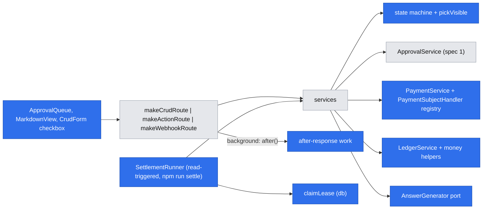
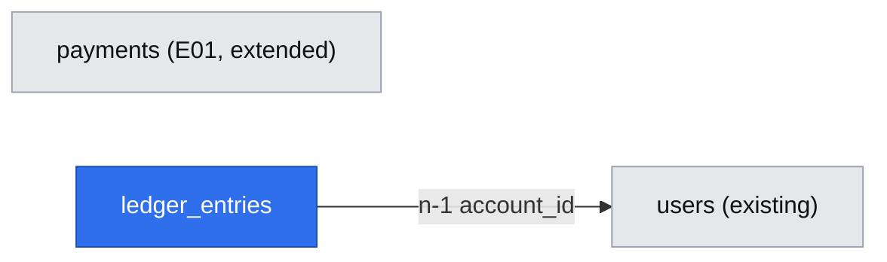

# Pilot primitives 2: settlement, payable subjects, state-dependent fields, money split and ledger, AI port, content UI

Status: Draft for review (open questions Q1–Q8 of the E02 gate answered by the requester 2026-10-27: Q1 = this separate spec, Q2 = after the pilot start 2026-11-02, Q3–Q8 as recommended). Third spec of the pilot series (after the primitives spec and the E01 spec; their "of 2" numbering is not changed). **Depends on** `2026-10-26-pilot-primitives.md` (its Phases 1–4) and, for the adoption phase, on `2026-10-26-pilot-booking-flow.md` (E01). **First consumer:** `2026-10-27-pilot-vault-answers.md` (issue #8, E02). Design authority `.ai/specs/product-brief.md`.

## 📝 TLDR

Reading the whole backlog (E01–E03, issues #7–#23) against the primitives spec shows ten repeated kinds of functionality that spec does not yet cover, because E01 alone did not need them: work that becomes due with time and runs without workers, approval by several people (identified, implemented locally in E02), paying for more than one kind of thing, content visible only in some states to some actors, money split among parties, calling an AI and trusting only what can be checked, and rendering user markdown safely. **Proposed (future behavior):** add a primitive for nine of them (the tenth, approval by several people, is built locally in E02), each with a named consumer in E02 and, where E01 already contains the same logic by hand, a retrofit of that code so the app ends with one mechanism, not two. Five of them (ledger, AI port, `MarkdownView`, checkbox, `isPreviewRequired`) have E02 as their only consumer; that is a deliberate relaxation of spec 1's rule, explained in Proposed Solution. This spec changes no user-visible behavior.

## 📝 Resolved questions

| Q | Answer (requester, 2026-10-27) | Consequence |
|---|---|---|
| Q1 | Separate "primitives 2" spec (option b) | This spec merges before E02; E02 contains no primitive code |
| Q2 | E02 after the 2026-11-02 pilot start | E01 launches on its own ad-hoc code; Phase 2 and Phase 5 touch it afterwards, with E01's own tests as the safety net |
| Q4 | All cited mentors must approve; one rejection rejects the answer | Implemented locally in E02 (`vault_answer_reviews`); no shared multi-approver primitive (requester, 2026-10-27) |
| Q6 | AI behind a port; Anthropic adapter ships with E02 | Port, validation and mock live here |
| Q8 | Ledger without payout; remainder-cent rule confirmed by the owner as the E02 default | `splitEqually`, `ledger_entries` live here |

(Q3, Q5, Q7 are E02-only and are recorded in that spec.)

## 📝 Problem Statement

The primitives spec already warns that about nine concepts added one at a time drift apart. E01 (unmerged, not implemented) specifies four things by hand that E02 needs again with small differences: lazy settlement of due transitions, payments hard-wired to `booking_id`, and DTO field redaction written per DTO. Building E02 by copying them yields two versions of each in the first weeks of a live money flow; building the shared version now costs one more spec but is cheap while nothing is implemented. The pilot's money correctness (D16, D17) and counts (D05, D08) depend on these paths behaving identically for every payable thing.

### Kinds of functionality in the whole backlog

The table in the primitives spec lists the E01 kinds. This table adds what E02 and E03 reveal; every row must have a consumer or it is not built.

| Kind | Stories | Gap against spec 1 | Primitive (layer) |
|---|---|---|---|
| Work that becomes due with time, no workers | booking expiry (#13), answer generation retry and preview expiry (#16, #17), refund retry, retention sweep (#20) | E01 describes lazy settlement inside bookings only | `settlement` runner + `claimLease` + `background` hook (core + db) |
| Approval by several named people | cited mentors, each must approve (#16, D14) | spec 1's approval has one decider | **not generalized**: E02 implements it locally until a second consumer (R02) exists |
| Paying for more than one kind of thing | booking (#12), vault answer (#17), later session packs | `payments.booking_id` and a booking-only webhook handler | `PaymentSubjectHandler` registry, `payments.vault_answer_id` (core + db) |
| Fields visible only in some states to some actors | seeker question and e-mail (#13), vault answer text before release (#16) | each DTO re-implements it | `pickVisible` in `defineStateMachine` (core) |
| Money split among n parties, auditable | mentor credits (#17), payout (#22), counts (#23) | helpers cover a single price | `splitEqually`, `shareOf`, `ledger_entries` (core + db) |
| AI output used as a product feature | vault answer (#17), later AI note drafting (E04) | none | `AnswerGenerator` port + validator + mock (core) |
| Policy bounded by a date | previews until 2026-12-14 (D18); the retention sweep (#20) may reuse it later | none; one consumer today | `isPreviewRequired` (core) |
| Queue of items awaiting my decision | operator refunds (#13), mentor previews (#16), later session-note approval (R02) | E01 builds the operator page by hand | `ApprovalQueue` (ui) |
| User markdown rendered safely | notes (#15), answers (#17), E01 code fences | none | `MarkdownView` (ui) |
| Form fields beyond text | consent checkbox (#15, #21) | `CrudForm` has text, email, password, textarea only | `checkbox` field + `description` (ui) |

Reused from spec 1 (the ones marked * are extended by this spec, additively): `defineStateMachine`*, `transitionStatus`* (must be able to join a caller's transaction, see Layering), `makeCrudRoute`*, `makeActionRoute`* (optional `background`), `makeWebhookRoute`, access helpers, `PaymentGateway`, `Mailer`, `Clock`, `ApprovalService`*, `StatusBadge`, `ActionButton`, `usePolling`, `apiCall`, `DataTable`, `feedback/*`.

## 📝 Proposed Solution

Same rules as spec 1: four packages, no module runtime. Spec 1 built a primitive only when the table showed a repeated kind **and** E01 consumed it, and kept `AnswerGenerator`, the ledger and the retention sweep contract-only. This spec deliberately relaxes the second half for E02, which is committed scope with decided business rules (D06, D09, D10, D11, D14): a primitive may have E02 as its only consumer if it is a distinct kind in the table. Those single-consumer items are marked and are the first to drop if E02 is cut. `settlement`, state-dependent fields and payable subjects also have an E01 consumer (Phase 5). Everything here is additive to spec 1's contracts (new tables, new optional fields, a new column with a default) **except one**: `transitionStatus` must join a transaction opened by the caller. Spec 1's Phase 1 step 2 was amended for that on 2026-10-27 (requester approved), so nothing in spec 1 needs to change later.

Alternatives considered:
- **Put all of this into spec 1 before it ships** (rejected by the requester, Q1): it would delay the E01 launch that the pilot start depends on.
- **A job queue or scheduler** for due work: rejected, same reasons as spec 1 (no workers, serverless-style hosting). `settlement` is lazy plus a cron-ready script, which is what E01 already chose.
- **Polymorphic `payments(subject_type, subject_id)`**: cleaner for a third payable thing, but needs a backfill and a column drop on a live money table; a sibling column with a check constraint is additive. Revisit when a third subject appears.
- **A shared multi-approver mechanism** (assignments, rules, outcome handlers, a repair task): rejected for now; only the vault needs it, and a vault-local review table decided inside the decision's own transaction needs none of that machinery. Extract one when R02 brings a second consumer.
- **A double-entry ledger, a platform account and reversal entries**: rejected for the pilot; one credit row per mentor per source is enough to show a balance and to feed the E03 payout. Refunds after release are not supported in code (see E02 Risks).
- Market reference (general knowledge, not freshly verified): Cal.com-style booking engines keep payment per booking and settle by cron; Stripe Connect models transfers against a separate balance transaction ledger. We copy the shape of an append-only balance ledger, not the product.

## 📝 Architecture



Takeaway: due work and after-response work are the only two ways something happens without a user click; both end in the same idempotent `transitionStatus`, and a crash in either is repaired by the next settlement pass, never by a human.

## 📝 Backend primitives

### 1. Settlement (`core/src/workflow/settlement.ts`, `db/src/repositories/lease.ts`)

```ts
interface SettlementTask {
  name: string;                       // 'bookings.expire', 'vault-answers.retry-generation', ...
  run(ctx: { limit: number }): Promise<{ processed: number }>;
}
```

- Tasks are registered **by hand** in `container.ts` (one line each); `SettlementRunner.runDue({ only?, limit = 20 })` runs them in order, catches and logs per-task errors (never throws), and returns counts.
- **Task classes (this widens E01's GET rule and supersedes its wording "expiry only"; E01's API table gets the same note in Phase 5):** each task declares `class: 'db' | 'external'`. A **`db` task** touches no provider and writes no ledger or payment rows: it only changes lifecycle status through `transitionStatus` and inserts approval or refund *request* rows (examples: booking expiry, vault review expiry). An **`external` task** calls a provider **or writes money records**: payment reconcile, refund execution, AI generation. **Triggers:** (a) `settleOnRead(names)` runs `db` tasks inline on a GET, throttled in process (default 10 s) and bounded by `limit`; (b) `external` tasks never run inline in a GET: a read may only hand them to `background`, where the lease and the attempt cap bound them; (c) `npm run settle` runs both classes (cron-ready; E01's `bookings:settle` becomes an alias in Phase 5). Opening a refund request on expiry is therefore `db` (an insert); **executing** the approved refund is the `external` task `refunds.execute` (Phase 2). A user's own POST (decline, reject) still triggers `refunds.execute` through `background` at once. A GET-triggered task never writes user content, ledger or payment rows.
- **A task must be idempotent and safe to run concurrently.** It finds due rows through a repository method (`findDue*`, in `db`) and acts only through `transitionStatus` or `claimLease` plus `transitionStatus`.
- `claimLease(em, { entity, id, leaseColumn, attemptsColumn, leaseMs, now, where? }) → boolean` in `db`: `UPDATE … SET lease=now, attempts=attempts+1 WHERE id=? AND (lease IS NULL OR lease < now-leaseMs) AND <where>`; `where` is a read-only predicate on the row (typically the statuses it must still be in) and there is **no `patch`**, so a lease claim can never write a lifecycle column. True when this caller got the lease. It is the only way a retry worker takes a row, so two concurrent passes never run the same attempt. **A task selects every row it may work on regardless of the lease** (the lease is a gate inside `claimLease`, never part of the selection), so a crash between the claim and the following transition leaves a row that the next pass picks up again. **The attempt counter is incremented at claim time, so a crash during the last allowed attempt leaves attempts at the cap: every lease-based task must also select rows at or above the cap whose lease is stale and move them to its terminal failure state with the refund path, never leave them.** `releaseLease(em, { entity, id, leaseColumn, retryAfterMs, leaseMs, now })` is called when an attempt fails and may be retried: it sets the lease so the row becomes claimable after the back-off, not after a full lease period; the attempts counter stays.
- **After-response work.** `makeActionRoute`, `makeCrudRoute.create`, `makeCrudRoute.list` and `makeCrudRoute.read` accept an optional `background: (task: () => Promise<void>) => void`. `core` stays framework-free; a route file passes Next's `after` explicitly (`import { after } from 'next/server'`), which keeps the dependency visible with grep. A background task must tolerate not running (process killed, platform limit): it only does work a settlement task can redo. **A GET reaches `external` work only through this hook** (a read service hands the stuck rows to `background`), which is why it exists on `list` and `read`.
- **Scheduler (decided by the requester 2026-10-27): a platform cron runs settlement.** It is a deployment requirement and a gate before any live payment (E02 Gate summary). The script entry is `npm run settle`; ⚠ if the platform's cron can only call HTTP, the entry point is an internal route (`POST /api/internal/settle`, no session, no CSRF like the webhook, guarded by a secret token compared in constant time, `404` when the token is unset). The hosting platform is not named in the brief, so that route is not designed further here. The `background` hook of the polled reads stays as a second, faster recovery path.

### 2. Approvals for several people: not built here

Only the vault needs approval by several people (D14), and the rule of this series is a repeated kind. E02 implements it locally: `vault_answer_reviews`, one row per cited mentor, decided inside the decision's own transaction together with the status change and, on the last approval, the release, so there is no outcome-handler saga and no repair task. Spec 1's `ApprovalService` (one decider, refunds) is untouched except that auto-approval no longer executes the refund inline (Backend 3); E02 uses it only to open refund requests. Extract a shared mechanism when a second consumer exists (R02, session-note approval).

### 3. Payable subjects (`core/services/payments`, `db`)

- `PaymentSubjectHandler { type: 'booking' | 'vault_answer', expectedAmount(subjectId): Promise<{ amountMinor, currency }>, onPaid(subjectId, payment), onFailed(subjectId, payment) }`, registered by hand in `container.ts`. `PaymentService.handleEvent` (webhook and reconcile share it, as in E01) loads the payment, dispatches to the handler by the payment's subject, checks `amount_total` against `expectedAmount`, and is a replay no-op through `transitionStatus`.
- `payments`: **this changes E01's table** (spec E01 defines `booking_id` as unique and not null): `booking_id` becomes nullable, new nullable unique `vault_answer_id`, check `num_nonnulls(booking_id, vault_answer_id) = 1`. It is a relaxation applied by migration after E01 is live, so E01's own migration and tests are untouched. Both columns stay plain uuid (no foreign key across concepts, as elsewhere). `reconcile` generalizes to `PaymentService.reconcile(subjectType, subjectId)`; the HTTP routes stay per concept.
- **Refund execution is subject-generic and always after commit:** `PaymentService.refund(subjectType, subjectId, approvalId)` finds the payment by the subject's column and calls `PaymentGateway.refund` with the approval id as the idempotency key; E01's refund execution for bookings moves onto it with the booking handler (Phase 2). **`ApprovalService.request` only inserts, and auto-approval (system actor) only marks the request approved; neither calls the gateway.** Execution is the `external` task `refunds.execute`, started through `background` right after the transaction commits (a user's own POST) or by `npm run settle` or a read's `background` hook; no gateway call may happen inside `UnitOfWork.run` (tested). This changes E01's "runs the refund in the same request" (E01 Phase 4 step 2) in mechanism, not in what the user sees.
- **Money taken, nothing to deliver is never only a log line.** When `handleEvent` sees a successful payment that the handler cannot apply (the subject is already `payment_failed`, was removed, or the amount differs) it records the payment as `succeeded`, does not touch the subject, and inserts a refund request (`operator_initiated`, reason `payment_orphaned`) that shows in the operator queue.
- The Stripe adapter and `PaymentGateway` are untouched; `idempotencyKey` stays `<subject>-<id>`.

### 4. State-dependent fields (`core/src/workflow/state-machine.ts`)

`defineStateMachine` gains an optional table:

```ts
fields: { question: { visibleTo: { mentor: ['paid', 'accepted'], seeker: '*' } },
          counterpartEmail: { visibleTo: { mentor: ['accepted'], seeker: ['accepted'] } } }
```

- **Actor names belong to the machine** (`mentor`/`seeker` for bookings, `seeker`/`assignee`/`operator` for vault answers). A relation that depends on the subject ("this user is a cited mentor of this answer") is resolved by the DTO mapper before it calls the machine; per-person progress (this assignee already decided) is not machine state and is exposed by the consumer as a boolean computed from the assignment (`canDecide`), not by `allowedActions`.
- `visibleFields(status, actor): ReadonlySet<string>` and `pickVisible(dto, machine, status, actor)`. **Every DTO key must be declared in `fields` or listed in an explicit `public: [...]` list** (fail closed): a generic test fails when a DTO key is neither, so a new sensitive column cannot leak by default. A declared field with no rule for an actor is hidden.
- Because the table is data, one generic test iterates every status × actor of every machine and snapshots the visible set, replacing hand-written per-DTO tests.
- DTO mappers call `pickVisible`; servers still put `allowedActions` in DTOs (spec 1).

### 5. Money (`core/src/constants/pricing.ts`, `core/src/utils/money.ts`, `ledger_entries`, `LedgerService`)

- `splitEqually(amountMinor, n): number[]`: integer minor units, sums exactly to the input; the remainder cents go one each to the **first** entries in the order given (an explicit, documented rule; the owner confirmed the E02 default on 2026-10-27). `shareOf(amountMinor, basisPoints)`: floor; the remainder stays with the platform. Property tests: sum invariant for n = 1..20 and amounts 0..100000.
- Constants (server-side only, D16, D11): `VAULT_ANSWER_PRICE_MINOR = 1000`, `MENTOR_SHARE_BP = 8000`. The 80% is computed on the price before payment fees (fees are not set in the brief; D11 says "80% of the price paid").
- `ledger_entries` (append-only, credits to mentors only):

| Column | Notes |
|---|---|
| `account_id` | the mentor's user id |
| `amount_minor` | positive |
| `currency` | `EUR` |
| `livemode` | copied from the payment at release; test-mode and mock credits are never payable |
| `source_type`, `source_id` | e.g. `vault_answer`, answer id |

Unique (`source_type`, `source_id`, `account_id`). `record` inserts with `ON CONFLICT DO NOTHING` and returns the inserted count; if rows for the key already exist with a different amount or `livemode` it throws `ConflictError`, so a replay is a no-op and never silently changes a split (a raw unique violation would abort the caller's transaction). No update or delete path exists in the repository. The platform's share is derived (price minus credits), not stored. `LedgerService.record(entries)` and `balanceOf(accountId, { livemode = true })`; `record` must run inside the caller's transaction (see Layering). No reversal, payout, transfer or withdrawal: refunds after release are handled outside the code in the pilot (E02 Risks) and payout is E03-S02.

### 6. `AnswerGenerator` port (`core/services/ai/answer-generator.port.ts`, mock adapter, `validate-generation.ts`)

```ts
interface NoteForPrompt { id: string; mentorId: string; mentorName: string; title: string; body: string }
generate(input: { question: string; notes: NoteForPrompt[]; idempotencyKey: string }):
  Promise<{ answerable: false } | { answerable: true; text: string; citations: string[]; usage?: { inputTokens: number; outputTokens: number } }>
// throws GeneratorError { kind: 'refused' | 'unavailable' | 'invalid_output' | 'config' }
```

- **`validateGeneration(result, notes)` is part of the port, not of the adapter:** citations must be non-empty, de-duplicated, at most `maxCitations` (a parameter; E02 passes 3, bounding how many mentors an answer can wait for), and a subset of the input note ids; no verbatim run of 80 or more characters (whitespace-normalized) of a note that was **not** cited may appear in the text (guards against leaking a mentor's note whose owner never reviews the answer); text length within bounds; otherwise `invalid_output`. D10 ("shows the mentor's name and the source note's title") is therefore enforceable: an answer without a verifiable citation cannot be released.
- Adapter rules in the contract: inputs are untrusted data, never instructions; no tools; the output is only text plus note ids; no raw HTML is produced or trusted (the UI renders through `MarkdownView`).
- Mock adapter (default in dev and CI): deterministic; cites the notes whose title words occur in the question, else the first note; special tokens in the question (`[mock:unanswerable]`, `[mock:invalid]`, `[mock:refused]`, `[mock:unavailable]`) drive the failure paths, honored only when `NODE_ENV` is not `production` or `AI_ALLOW_MOCK_IN_PRODUCTION=true` (which is refused when `PAYMENTS_LIVE_ENABLED=true`, so the rehearsal on staging can exercise them and live money cannot). Contract tests every adapter must pass are written once here.
- The Anthropic adapter is in the E02 spec.

### 7. Preview window (`core/src/constants/pilot.ts`)

`isPreviewRequired(clock)` reads env `VAULT_PREVIEW_UNTIL` (ISO instant; default end of 2026-12-14 in Europe/Warsaw, D18). ⚠ "until 2026-12-14" is read as inclusive of that day, an author's reading to confirm. Nothing else is added: `PILOT_START` and a retention constant have no consumer until the retention sweep (#20) is specified.

### Layering and transactions

Spec 1 puts the atomic write in `db` (`transitionStatus(em, …)`) because `core` may not import MikroORM. Composing it with other writes needs a port `core` can see: **`UnitOfWork.run(fn)`**, an interface in `core/src/container` implemented in `db` on the scope's own `EntityManager` (begin, run, commit or roll back), so every scoped repository of that scope joins the same transaction. **Spec 1 was amended so that `transitionStatus` has this behavior from the start:** called alone it keeps its own one-transaction guarantee; called inside `UnitOfWork.run` it joins the open transaction (flat, never nested). "Status change + ledger entries" and "decision + aggregate" commit or roll back together through it. Phase 1 step 1 builds the port first and proves the composition with an integration test before any consumer relies on it. ⚠ MikroORM's behavior for repositories bound to a forked `EntityManager` inside a manual transaction is not verified here; the test is the first step for that reason.

## 📝 Frontend primitives (`ui`, independent of `core`)

| Primitive | Place | Contract |
|---|---|---|
| `ApprovalQueue` | `backend/approvals/` | `{ fetcher, renderItem(item), onDecide(id, 'approve'\|'reject', reason?) → ApiResult, emptyText }`: `DataTable` states, one `ActionButton` pair per row driven by the item's `allowedActions`, optional reject-reason textarea (≤500), `aria-live` result line. The concept supplies `renderItem` (it knows the domain shape) |
| `MarkdownView` | `backend/content/` | `{ source, className?, linkPolicy?: 'safe' \| 'none' }` (`none` renders link text without a link; AI output uses it): markdown to React elements with **no raw HTML** (`skipHtml`), images disabled, links limited to `http(s)` and `mailto` with `rel="noopener noreferrer nofollow"`, code fences in monospace, no script or style path. Uses the `react-markdown` package without `rehype-raw`; ⚠ the exact option names are checked against the installed version in Phase 4 step 2 (not verified here), and `npm run audit:prod` must stay green |
| `CrudForm` additions | `backend/forms/` | field `type: 'checkbox'` (state boolean, the shared schema sees a boolean, e.g. `z.literal(true)` for consent) and an optional `description` (helper text under the label, wired by `aria-describedby`); shadcn `checkbox` added through the CLI as the standards require. Existing `textarea` is reused as is |
| `usePolling`, `StatusBadge`, `ActionButton` | spec 1 | reused |

## 📝 Data Model

New or changed tables; conventions as in spec 1 (UUID ids, snake_case plural tables, plain uuid user references, migrations with a hand-checked `down()`).

| Table (concept) | Change |
|---|---|
| `ledger_entries` (ledger) | new, see Backend 5 |
| `payments` (payments) | `booking_id` nullable, `vault_answer_id` nullable unique, check one-of |



Sensitive data: the ledger holds ids and amounts only.

## 📝 API Contracts

No product endpoints. New internal contracts are the signatures above. New env (zod, lazy, `.env.example`): none in this spec except `VAULT_PREVIEW_UNTIL` (read by `isPreviewRequired`; unset = default). The AI environment arrives with the adapter in E02.

## 📝 UI/UX

Showcased on `ui-preview` with every state: `ApprovalQueue` (loading, empty, error, row busy, row error), `MarkdownView` (headings, code fence, blocked HTML and image, hostile link), `CrudForm` checkbox (unchecked required, server error). Accessibility: checkbox has a visible label and described-by text; queue result line is `aria-live="polite"`; reject reason has a label.

## 📝 Edge Cases & Failure Scenarios

| Scenario | Behavior |
|---|---|
| Two settlement passes run at once | `claimLease` gives the lease to one; the other skips the row; a replayed transition is a no-op |
| Settlement task throws | Logged with the task name, other tasks still run, the request that triggered it is unaffected |
| Process dies during `after()` work | Row stays in its in-progress status with a stale lease; the next pass retries it |
| Webhook for a vault payment whose answer was removed, or a late success after the answer was marked `payment_failed` | Payment recorded as `succeeded`, subject untouched, a refund request (`payment_orphaned`) opened for the operator |
| Amount mismatch on a vault payment | Same as bookings: not marked paid, logged, and a refund request opened for the operator to decide |
| Ledger `record` called twice for one source | `ON CONFLICT DO NOTHING`: a no-op; a replay with a different amount or `livemode` throws `ConflictError` |
| Money split of 800 over 3 | `[267, 267, 266]`, sums to 800 |
| Markdown with `<script>`, `javascript:` link, image beacon | Rendered as inert text or dropped; no network request is made by the view |
| `VAULT_PREVIEW_UNTIL` malformed | Falls back to the default and logs once; never "no preview" by accident (fail closed) |

## 📝 Risks & Impact Review

- **Hard to reverse:** `ledger_entries` shape (append-only, money) and the `payments` check constraint once live data exists; tables reverse by `down()` until real rows exist.
- **Premature-abstraction risk:** every primitive names an E02 consumer. `settlement`, state-dependent fields and payable subjects also have an E01 consumer (Phase 5); `ApprovalQueue` has E01's operator page as a second consumer only once Phase 5 step 4 lands. Single-consumer items: ledger, `AnswerGenerator`, `MarkdownView`, the checkbox, `isPreviewRequired`. If E02 is cut, drop those first.
- **Scope of this spec:** it bundles backend primitives, frontend primitives and a retrofit. The requester chose one primitives spec (Q1); if review prefers smaller merges, the natural cut is (a) settlement + state-dependent fields, (b) payable subjects (the only part that alters an E01 table), (c) the Phase 5 retrofit, with the single-consumer items moved into the E02 spec. The phases below already follow those seams.
- **Touches live money code after 2026-11-02:** Phase 2 (payments handler registry, required by E02) and Phase 5 (bookings expiry, DTOs, operator page). Mitigations: characterization tests first against current behavior, each change its own PR, `risk-high`, E01 rehearsal scenarios re-run. Phase 5 can be dropped without affecting E02; Phase 2 cannot.
- **Next.js:** `after` and route behavior come from the installed version's docs (`node_modules/next/dist/docs/01-app/03-api-reference/04-functions/after.md`: runs after the response, bounded by the route's max duration, supported with `next start`, drained on graceful shutdown). Read them again before Phase 1 step 5 (the `background` hook), as `AGENTS.md` instructs.
- **Rule checks:** no raw `fetch`, no route `try/catch`, no RBAC, no auto-discovery, `@mikro-orm` only in `db`, event payloads carry ids only, `core` does not import `next`.
- **Not verified:** `react-markdown` option names, MikroORM pessimistic lock mapping, `em.transactional` composition with `transitionStatus`, Postgres expression-based unique index through the MikroORM migration runner. Each is a first-step test, not an assumption.

## 📝 Decisions in play

Relied on: D05/D08 (counts), D11 (80% equally), D14 (several mentors), D16 (price as a constant), D17 (refunds via approval), R02, N01, N02. No new decision record; nothing here contradicts an active decision.

## 📋 Phasing

1. Workflow additions: `pickVisible`, `claimLease`, `settlement`.
2. Payable subjects (the only part that alters an E01 table), done **after E01 is live**, per Q2.
3. Money and AI: `money`, `ledger_entries`, `AnswerGenerator` port + mock + validator, pilot window.
4. Frontend: `CrudForm` checkbox, `MarkdownView`, `ApprovalQueue`.
5. Adoption in E01 (after the launch, optional for E02): bookings expiry on settlement, `BookingDto` on `pickVisible`, operator approvals page on `ApprovalQueue`, the GET-rule note in E01's API table.

Phases 1, 3 and 4 need only spec 1; Phase 2 needs E01's `payments` table and code, i.e. it lands after 2026-11-02. Each phase is mergeable alone and none changes user-visible behavior. Phase 5 changes live code behind existing tests.

## 📋 Implementation Plan

Validation after every step: `npm run type-check && npm run lint && npm test && npm run build`; integration steps add `npm run test:integration`. "T:" is the test that must fail without the step. Packaging rule as in spec 1: new `core` exports by hand in `core/src/server.ts` (client-safe ones in `src/index.ts`), `db` exports in its index, env in `.env.example`, read lazily.

### Phase 1 — Workflow additions
1. `UnitOfWork` port in `core` and its `db` implementation; `transitionStatus` (as amended in spec 1) joins an open transaction. T (integration): a thrown error inside `UnitOfWork.run` rolls back `transitionStatus` and an unrelated insert together; `transitionStatus` alone still commits by itself. Blocks the rest of the series if it fails.
2. `fields` table, `public` list, `visibleFields`, `pickVisible` in `state-machine.ts`. T: generic status × actor snapshot; an undeclared actor sees none of a declared field; a DTO key neither declared nor public fails the generic test.
3. `claimLease` (no `patch`) and `releaseLease` in `db` + integration tests. T: 20 concurrent callers, exactly one true per lease period; after `releaseLease` with a back-off the row is claimable only after it; a row whose lease is set but whose status never advanced is still selected by the finder; a row at the attempt cap with a stale lease is selected for failing; `claimLease` inside `UnitOfWork.run` rolls back with the rest.
4. `SettlementRunner` with task classes, `settleOnRead` (runs `db` tasks only), `npm run settle` (`core/scripts/settle.ts`, ts-node as in spec 1's scripts). T: a throwing task does not stop the next; throttle skips a second call inside the window; an `external` task is never run by `settleOnRead`.
5. `background` option on `makeActionRoute` and on `makeCrudRoute.create`, `.list` and `.read` (type only in `core`). T: option absent = no behavior change; present = task invoked after the handler resolved, its error logged, response unaffected; a GET starts an `external` task only through it.

### Phase 2 — Payable subjects (after E01 is live)
1. Characterization tests of the current booking payment handling first; then migration `payments` (nullable `booking_id`, `vault_answer_id`, check), the `PaymentSubjectHandler` registry in `container.ts`, `PaymentService.handleEvent` dispatching to it with the booking handler moved unchanged, `PaymentService.refund(subjectType, subjectId, approvalId)` with E01's booking refund execution moved onto it, and the `external` task `refunds.execute`. T: the characterization tests (including a booking refund) still pass; a vault-subject refund calls the gateway once with the approval id as key; webhook replay → one `onPaid`; amount mismatch → handler not called; unknown subject → recorded and a refund request opened; a late success after `payment_failed` → refund request `payment_orphaned`; `ApprovalService.request` never calls the gateway and no gateway call happens inside `UnitOfWork.run` (E01's characterization "refund in the same request" becomes "refund started right after commit").

### Phase 3 — Money and AI
1. `money.ts` (`splitEqually`, `shareOf`) and constants. T: property tests of the sum invariant.
2. `ledger_entries` entity (with `livemode`), migration (unique source key), repository without update/delete, `LedgerService` (`record` with `ON CONFLICT DO NOTHING`, `balanceOf` filtered by `livemode`). T: duplicate `record` is a no-op; a replay with a different amount → `ConflictError`; test-mode credits are excluded from the default balance; a failure inside `UnitOfWork.run` leaves no entries.
3. `AnswerGenerator` port, `validateGeneration` (with `maxCitations` and the uncited-note overlap guard), error kinds, mock adapter (special tokens under the production rule above), shared adapter contract tests. T: unknown citation id, empty citations, more than `maxCitations`, oversized text, a verbatim 80-character run from an uncited note → `invalid_output`; mock honors the special tokens.
4. `constants/pilot.ts` with `isPreviewRequired(clock)` only. T: boundaries on both sides of the instant; malformed env falls back and requires preview.

### Phase 4 — Frontend
1. `CrudForm` `checkbox` + `description` (shadcn `checkbox` via CLI). T: required-checkbox schema error shown; boolean reaches `onSubmit`.
2. `MarkdownView` (add `react-markdown`, check options against the installed version). T: `<script>`, `javascript:` link and image render inert or are dropped; fenced code is monospace; `linkPolicy: 'none'` renders no `<a>`.
3. `ApprovalQueue` + `ui-preview` showcase. T: row error shown and button re-enabled; empty state; reject sends the reason.

### Phase 5 — Adoption in E01 (after 2026-11-02)
1. Characterization tests for booking expiry, `BookingDto` visibility and payment handling as they behave on `main`.
2. Booking expiry moves to a `bookings.expire` settlement task; `bookings:settle` becomes an alias of `settle`. T: unchanged characterization results.
3. `BookingDto` uses `pickVisible` (question, counterpart e-mail). T: the generic snapshot equals the E01 per-status DTO tests.
4. Operator approvals page renders through `ApprovalQueue`.
5. E01's API table gets the task-class note (GET runs `db` tasks only; `external` tasks go through `background` or the script).

### Close-out
Extend the primitives catalogue in `engineering-standards.md` and the Reusable layer paragraph of `AGENTS.md` with the new primitives; lesson entry for anything non-obvious (most likely the transaction composition result); move this spec to `.ai/specs/implemented/` after E02 Phase 4 has consumed Phases 1–4.
