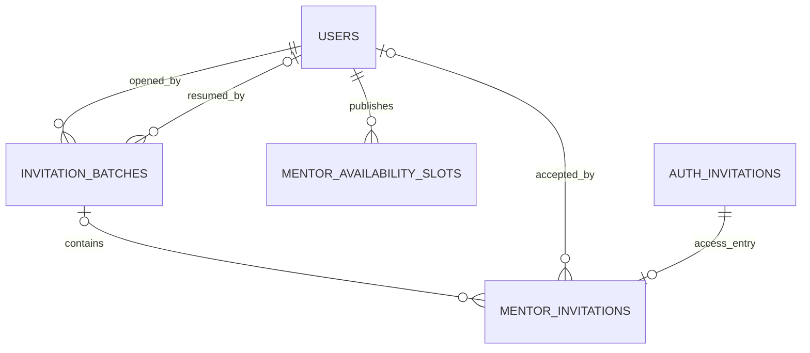

# Operator invitation batches

## 📝 TLDR
Operators need to invite beachhead mentors in groups of 20 and measure whether accepted mentors publish availability within the saved invitation window. This adds a separate outreach record and operator workflow while preserving the current pilot access invitations and magic-link login.

## 📝 Problem Statement
The task brief describes operators sending invites through a script and tracking activation in a shared note. The current branch has `packages/core/scripts/pilot-invite.ts` and `auth.invitations`, which are an allowlist used by invitation-based pilot login; they do not send outreach mail, track expiration or connect to availability. No batch invitation issue/spec existed. Epic #42 and story #43 were created from the task brief.

The task references issue #30, but GitHub #30 is a closed PR about mentor GitHub profile links. It is unrelated and provides no acceptance criteria. The story #43 captures the supplied acceptance criteria instead.

## 📝 Resolved design decisions
- Outreach uses a new `MentorInvitation` entity and `InvitationBatch`; it does not add fields or constraints to `auth.invitations`. Existing pilot login eligibility and magic-link acceptance remain intact.
- After a successful existing magic-link acceptance, an additive hook records the matching outreach invitation's `acceptedAt` and `acceptedByUserId`. It does not change login eligibility, token consumption, or the accepted access invitation.
- The current mailer adapters only support `magic-link`, `booking-question`, and `booking-accepted`. A new `mentor-invitation` template is added to the existing adapters to satisfy the required message. This scope exception was approved by the user.
- The current `CrudForm` has no multiselect field. Add an accessible multiselect field type and component tests. This scope exception was approved by the user.
- No `StackTags` enum exists. The four provisional options are TypeScript, Next.js, Node.js, and Python, derived from current seeded/test mentor technologies. Confirm this product list before launch.
- The user brief's `MENTOR_PUBLISH_WINDOW_DAYS` setting does not exist on this branch. Add an optional validated setting with a default of 14 days, and calculate each `publishDueAt` once on acceptance.
- New invitation acceptance links expire after 30 days, matching the existing reusable account-link lifetime. Existing magic-link token verification remains the acceptance surface. This is a reversible default; no product TTL was found in the brief.
- The existing operator surface is `/operator` and authorization uses `requireOperator` / `requirePanelAccess`; implement the requested page at `/admin/invitations` and add it to the current operator navigation after Users.
- No `InvitationBatch` UI component exists in the current branch. Create the requested component at the named path and add stories/tests.

## 📝 Delta

### Capability: invite-mentors-in-batches
- **ADDED** WHEN an operator explicitly opens a batch, THEN the next sequential batch opens only if there is no open batch and invitations are not stopped.
- **ADDED** WHEN an operator sends an invitation, THEN one transaction reserves a slot in the open batch, creates an outreach record and access allowlist entry if needed, issues the acceptance link, and sends the invitation email. A rejected email rolls back database writes and returns the specified 503.
- **ADDED** WHEN the 20th invitation is accepted by the batch service, THEN the batch closes permanently. Revoked and expired invitations still consume a slot.
- **ADDED** WHEN batch 1 contains 20 invitations and none are waiting for acceptance or within the publish window, THEN fewer than five published slots stops all new invitations and batch openings until `resumedAt` is set. No product action sets `resumedAt` in this feature.
- **ADDED** WHEN an operator visits the invitation page or APIs, THEN batch counters, invitation statuses, and pre-batch invitations are visible. Guests receive 401 from APIs; signed-in non-operators receive 403 and cannot see the navigation link.

### Capability: measure-mentor-slot-publication
- **ADDED** WHEN status is calculated at injected `now`, THEN apply this exact precedence: Revoked; Waiting for acceptance (`acceptedAt` absent and `expiresAt > now`); Expired, not accepted (`acceptedAt` absent and `expiresAt <= now`); Published a slot (accepted and the accepted user's mentor slot has `createdAt >= acceptedAt && createdAt <= publishDueAt`); Accepted, no slot yet (`now <= publishDueAt`); No slot within two weeks (`now > publishDueAt`).
- **ADDED** WHEN a qualifying slot is later cancelled, THEN it still counts because the slot row remains with its original `createdAt`. Slots before acceptance and after `publishDueAt` do not count.
- **ADDED** WHEN counters are shown, THEN Sent counts every row in the batch, Accepted counts rows with `acceptedAt`, and Published counts rows with status Published a slot.

## 📝 Architecture
- `packages/core/src/services/invitations/mentor-invitation.service.ts` owns one create operation, batch opening/listing, status calculation, operator checks, stop-rule calculation, and mail send. It uses the injected `Clock`, existing mailer port and DB repositories.
- `packages/db` owns `InvitationBatch` and `MentorInvitation` entities, repositories, transaction/locking, and one reversible migration. Legacy `auth.invitations` with role `mentor` are copied into outreach rows with `batchId = null` for the Created before batches section; their pilot-access rows remain unchanged.
- Successful magic-link acceptance adds the accepted timestamp/user to the matching pending outreach row. No invitation login semantics change.
- `packages/app` adds `/api/operator/invitation-batches` GET/POST, `/api/operator/invitations` POST, and `/admin/invitations`; routes use `apiHandler`, CSRF on mutations, and `requireOperator`. Services also enforce the operator requirement.
- `packages/ui` adds `InvitationBatch` at the requested path and extends `CrudForm` with accessible multiselect support. `apiCall` handles browser requests.
- `scripts/invite.ts` is not present; the compatible entry point is the existing `npm run pilot:invite` / `packages/core/scripts/pilot-invite.ts`. Add a `create` action that calls the same invitation service; preserve its existing list/revoke/resend behavior.

## 📝 Data Model
- `InvitationBatch`: unique sequential `number`; `openedBy` user FK; `openedAt`; nullable `closedAt`, `resumedAt`, and `resumedBy` user FK. A partial unique index permits at most one open batch. An advisory transaction lock serializes opening and invitation creation.
- `MentorInvitation`: normalized `email`; `displayName`; four-element allowlisted `stackTags`; nullable batch FK for migrated pre-batch invitations; accepted user FK/`acceptedAt`; `expiresAt`; `publishDueAt`; `revokedAt`; plus existing base `id`, `createdAt`, `updatedAt`. Do not persist or return the raw link token; existing login-token storage keeps only its hash.
- Migration adds the two tables, constraints/indexes and nullable FKs, copies mentor access invitations as pre-batch rows, and has a complete `down()` that removes only the new structures. Existing auth invitation columns and npm scripts remain.
- `MENTOR_PUBLISH_WINDOW_DAYS` is optional with default 14. It is read at the moment a mentor accepts and stored as `publishDueAt`; later configuration changes do not move existing deadlines.

## 📝 API Contracts
- `GET /api/operator/invitation-batches`: `{ batches: BatchWithInvitations[], stopped: boolean, preBatchInvitations: InvitationRow[] }`. Batch includes sent/accepted/published counters, state words and rows. Never include token/link/hash.
- `POST /api/operator/invitation-batches`: no body; opens the next number. Conflict messages are exactly those in the task brief.
- `POST /api/operator/invitations`: strict shared Zod body `{ email, stackTags }`; trim/lowercase email; require 1–4 unique supported tags; reject unknown fields/tags. Success returns only safe invitation/batch summary. Mail rejection returns 503 with the exact supplied message.
- All three routes verify operator access; GET has no CSRF requirement, both POST routes use the repository's CSRF-enabled `apiHandler` conventions.
- Other conflicts retain the task's specified unresolved-invitation/existing-mentor copy and map email conflicts to the email field.

## 📝 UI/UX
- Page `/admin/invitations` calls `requirePanelAccess('operator')` directly. Operator navigation adds “Invitations” directly after “Users”.
- Empty, open/full, stopped, and prior-batch states use the exact copy from the task brief. Opening a batch requires the exact confirmation dialog copy.
- `CrudForm` uses the API Zod schema with required email and a multiselect of the four StackTags. Invalid input shows field errors without a request; duplicate submission is blocked; server errors preserve input; success clears the form and refreshes counters without navigation.
- Extend `InvitationBatch` rather than creating a parallel component. Each batch shows Batch N, Open/Full/Stopped, counters, and Mentor/Stack tags/Status/Publish by columns. Dates use `packages/ui/src/time`.
- Render a narrow-screen layout at 390px without page-level horizontal scroll. Every control has an accessible label and keyboard operation. Empty cells get explicit fallback text; never expose raw internal status values or invalid date strings.

## 📝 Edge Cases & Failure Scenarios
- Serialize the 20th invitation and simultaneous open requests; exactly one request wins and batch numbering remains sequential.
- Reject invitation 21 without writes. Revoke/expiration do not return a slot.
- Status boundaries: slot created at `acceptedAt` and exactly `publishDueAt` counts; 1ms after does not. At `now === publishDueAt`, Accepted, no slot yet remains. `expiresAt === now` is Expired, not accepted.
- Deleted/cancelled-in-window slots count; pre-acceptance slots and post-deadline slots do not.
- Batch 1 with four published and no unresolved invitations stops; five does not. Do not resolve the rule while any first-batch invite is waiting or inside its window. A pre-opened batch 2 is also blocked after batch 1 resolves below threshold. `resumedAt` removes the stop.
- Existing unresolved email and existing mentor are rejected. Case/outer whitespace normalize to the same email.
- Mail rejection returns 503, leaves no outreach/access invitation or consumed batch capacity, and allows retry with the same email.
- Mentors, mentees, and guests are denied on page/API and never see the nav item.

## 📝 Risks & Impact Review
- The migration copies mentor access invitations into an outreach read model. Rollback removes that copied projection and all new batch/outreach data; it does not alter pilot access rows.
- Sending mail while holding the transaction lock is required to prevent a failed send from consuming capacity. A database commit failure after a successful external send can still deliver a link without a committed batch row; record and handle this failure as a retryable orphan-link risk.
- The task brief's use of D18 and R16–R18 is inaccurate for the current product brief. Keep the batch policy as a feature-specific rule pending product brief correction; do not edit D18/D19/D24 meanings.
- A published availability slot can be cancelled and still count. The feature follows creation time as required, even if the profile is unlisted or has no price.

## 📝 Decisions in play
- D04, D12, D18, D19, D24 and Q09 in `.ai/specs/product-brief.md` remain unchanged. The batch test is a new product rule; product owner should give it a new decision id and correct the missing R16–R18 references before launch.
- Open product follow-up: should “published a slot” require the profile to be listed and have a price so the slot is bookable? This feature follows the task's creation-time rule until the product owner decides otherwise.
- Open product follow-up: confirm that the four `StackTags` are TypeScript, Next.js, Node.js and Python.
- Reversible defaults to confirm before launch: 30-day invitation acceptance expiry (using the existing account-link lifetime) and a 14-day publish window default.

## 📋 Phasing
1. Data model, migration, repositories, deterministic status/stop logic, and unit/integration tests.
2. Single invitation creation transaction, mail template, access-link handoff, script compatibility, and concurrency tests.
3. Operator APIs, authorization tests, shared Zod schema, and API tests.
4. Responsive operator page, `InvitationBatch`, `CrudForm` multiselect, stories/component tests, and nav tests.
5. Browser scenarios/manual QA evidence, docs, full validation, independent review, and stage-only handoff.

## 📋 Implementation Plan
1. Add entities/repositories/migration and migrate legacy mentor access rows with nullable batch links; verify up/down/up integration.
2. Implement injected-clock status calculation and stop rule; test every boundary, slot deletion, re-invitation, and threshold.
3. Implement locked batch-open and single create method with transactional rollback on mail rejection; add the `mentor-invitation` template and verify no token/link appears in logs or API DTOs.
4. Integrate successful magic-link acceptance with outreach acceptance metadata without changing login policy; add acceptance tests.
5. Add API schemas/routes and ensure 401/403/409/503 envelopes and exact messages.
6. Add responsive operator page/nav and extend `CrudForm`/`InvitationBatch` with accessible controls and explicit states.
7. Update `pilot:invite` create path and `docs/DEVELOPMENT.md`; preserve revoke/resend behavior.
8. Add integration/browser coverage and manual QA screenshots; update coverage include and `nav.test.ts`.
9. Run the configured validation gate, review the exact diff, and stage only intended feature files.
