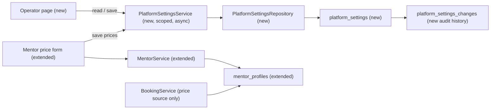
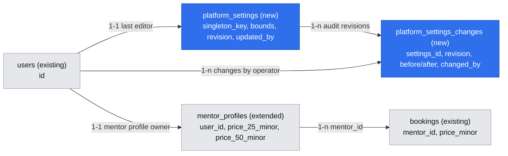

# Operator-managed session price bounds

Supersedes: `.ai/specs/2026-10-26-pilot-booking-flow.md` — sections: Data Model (booking price policy), API Contracts (`POST /api/bookings` price calculation), Risks & Impact Review (fixed price constant)

## 📝 TLDR
Operators need to change the allowed minimum and maximum prices for 25- and 50-minute sessions without a redeploy. Today, the application prices sessions with fixed global constants and stores no mentor prices. Future behavior stores bounds in one database settings row, lets mentors set a price inside those bounds, and gives operators a page to edit bounds and identify existing mentor prices outside them.

## 📝 Problem Statement
The current application has global session prices (`2500` and `5000` grosz) in `packages/core/src/constants/index.ts`; `BookingService.create` uses them regardless of mentor. There is no `PLATFORM_PRICE_BOUNDS` variable in this checkout, no `PlatformSettingsService`, and no price fields on mentor profiles. The requested operator report and “enforce on the mentor’s next price save” behavior therefore need a minimal per-mentor pricing path as well as persisted operator bounds.

Issue [#41](https://github.com/AdamMajbour/ai_techleaders_devmentors/issues/41) tracks the feature. The brief’s references to D09 and R08 do not identify session-pricing rules in the current product brief: D09 concerns vault-answer previews and earnings, and the brief has only R01–R05. Those references are treated as mistaken; the product direction below follows the explicit brief and the requester’s answers.

## 📝 Prior spec drift
- `.ai/specs/2026-10-26-pilot-booking-flow.md`, Data Model/API Contracts/Risks: says booking price is fixed at 2500/5000 grosz and a constant; current code agrees. This spec deliberately replaces only the session-price policy with mentor-owned prices inside operator-set bounds. Existing bookings retain their stored amount.
- `.ai/specs/product-brief.md`, D16: says a 25-minute session costs EUR 25 and the price is equal for every mentor; current code and the prior booking spec use 2500/5000 grosz in PLN. The requester confirmed founder A’s approval to supersede D16’s session-price portion with mentor-selected PLN amounts under operator bounds; D16’s vault-answer price is untouched.
- The referenced `PLATFORM_PRICE_BOUNDS` and `packages/core/src/services/operator/platform-settings.service.ts` are absent from this checkout. Per requester confirmation, initial 25-minute bounds are min=max=2500 grosz and 50-minute bounds min=max=5000 grosz; no new environment variable is introduced. The newly added settings service follows the repository’s scoped, asynchronous database-backed service pattern rather than the described singleton/synchronous contract.

## 📝 Proposed Solution
Add one singleton settings record containing four positive integer amounts in grosz, initialized to the current fixed prices as equal minimum and maximum values. Store each mentor’s 25- and 50-minute prices on its existing profile, backfill current profiles from the current fixed prices, and validate mentor price writes only through `PlatformSettingsService`. Booking creation snapshots the selected mentor’s stored price into the existing booking and payment amount fields; the rest of booking and checkout behavior stays as-is.

An operator-only page edits the four bounds and lists each mentor-duration pair currently outside the saved range. Such a mentor remains listed or unlisted exactly as before and keeps the same price until a mentor explicitly saves prices again. A successful settings save is append-audited. Concurrent edits use a revision check: one save succeeds and the other receives `409 Conflict` and must reload before retrying.

**Research:** Codementor’s published guidance lets mentors set their own rates, supporting the need for mentor-level price ownership. This spec keeps only that useful distinction and bounded 25/50-minute session prices; per-minute billing and transaction fees described by Codementor are outside this feature. [Codementor pricing guidance](https://support.codementor.io/en/articles/4224961)

Alternatives rejected: keeping prices in deployment configuration repeats the redeploy problem; silently changing or hiding out-of-range mentors contradicts the explicit grandfathering rule; last-write-wins could discard one operator’s edit without notice.

## 📝 Delta

### Capability: platform-session-pricing

#### MODIFIED Requirement: Session prices are fixed by duration
The system SHALL charge the selected mentor’s stored price for the chosen 25- or 50-minute session; each explicit price save is validated by `PlatformSettingsService`, while migrated or later-grandfathered prices remain usable until an explicit replacement save. The booking continues to snapshot that amount for checkout and later display.

##### Scenario: Mentor-specific price is charged
- WHEN a seeker books a 50-minute session with a mentor whose stored price is 6200 grosz
- THEN the booking snapshot and checkout amount are 6200 grosz, regardless of any client-supplied amount

##### Scenario: Existing booking keeps its agreed amount
- WHEN operator bounds or a mentor’s prices change after a booking is created
- THEN the existing booking and payment continue to use the amount already stored on that booking

Frozen by: `packages/core/src/services/bookings/booking.service.test.ts`; `packages/app/src/app/(marketing)/m/[slug]/mentor-profile-view.test.tsx`

#### ADDED Requirement: Operators manage session price bounds
The system SHALL allow only configured operators to read and save the four session price bounds; invalid saves SHALL be rejected and each accepted save SHALL be attributed to its operator and time.

##### Scenario: Operator saves valid bounds
- WHEN an operator submits positive integer grosz amounts with min <= max for both durations and the submitted revision is current
- THEN the new bounds become visible on the next request and an audit record identifies the operator, time, and before/after values

#### ADDED Requirement: Out-of-range mentor prices are reported without automatic action
The system SHALL show each mentor and duration whose saved price is outside the current inclusive range, without changing the mentor’s price, listing state, or visibility.

##### Scenario: Bounds change below a mentor’s current price
- WHEN an operator saves a maximum below a mentor’s existing price
- THEN the operator report marks that mentor and duration, while the price and listing state remain unchanged

#### ADDED Requirement: Mentor prices are checked on explicit price save
The system SHALL accept a mentor price save only when both submitted duration prices are within their current inclusive bounds; non-price profile edits SHALL not trigger revalidation of grandfathered prices.

##### Scenario: Mentor corrects an out-of-range price
- WHEN the mentor submits both prices within current bounds
- THEN the prices are saved and that mentor-duration entry no longer appears in the out-of-range report

## 📝 Architecture
`PlatformSettingsService` is the sole reader of price bounds. It is a scoped core service with asynchronous, uncached reads through a new settings repository; the repository and entity remain in `packages/db`. The service exposes current bounds, applies defaults for legacy profile-create requests, validates a pair of mentor prices, builds the out-of-range report, and performs an audited revision-checked update. `MentorService.updatePrices` delegates bound validation to it. `BookingService.create` reads the selected mentor’s stored amount and snapshots it as it already does; it accepts a persisted price even after bounds move past it, until the mentor explicitly saves a valid replacement. It does not compare a grandfathered price with today’s bounds, because doing so would silently block existing mentors.

The `core` DI cradle/container gains the settings repository and service as scoped registrations. All other bound consumers—operator page data, mentor price writes, and any future price validation—call `PlatformSettingsService`; none query the settings entity/table directly. Existing operator authorization is `OPERATOR_USER_IDS`; `OPERATOR_EMAILS` is not added. API routes use `requireSession`, `requireOperator`, `apiHandler`, the existing CSRF/Origin protections, and the standard response envelope. The existing dashboard and `app-shell.tsx` operator navigation gain the new link. No event is needed: there is no current settings-change subscriber.

Current and planned flow:

Takeaway: all policy decisions about bounds stay in one core service; bookings only snapshot the already accepted mentor price.

## 📝 Data Model

| Entity/table | Fields and constraints |
|---|---|
| `platform_settings` (new, exactly one row) | Existing UUID id and timestamps; `singleton_key` fixed to `1`, unique and checked; `price_25_min_minor`, `price_25_max_minor`, `price_50_min_minor`, `price_50_max_minor` are PostgreSQL signed `integer`, each `> 0`; each min <= matching max; `revision` starts at 1 and increments on every accepted write; nullable `updated_by` FK to users is the last operator id (null until the first operator save); `updated_at` is the last save time. |
| `platform_settings_changes` (new, append-only) | UUID id; `settings_id` FK to the singleton; revision; four previous and four new integer amounts; `changed_by` FK to operator user id; `changed_at` UTC timestamp. One row is inserted for each successful operator save in the same transaction as the settings update. FKs use restrictive deletion so settings/audit records cannot lose their actor identity. No email or free-text reason is copied into the audit record. |
| `mentor_profiles` (extended) | `price_25_minor`, `price_50_minor`, PostgreSQL signed `integer`, positive and non-null. Backfill existing profiles to 2500 and 5000 grosz, respectively. The mentor UI supplies both prices on create; legacy API clients omitting both receive current minimums, while a partial pair is rejected. |
| `bookings` (unchanged shape) | Existing `price_minor` remains the immutable amount agreed at booking time; new bookings copy the selected profile price. |

Migration initializes the singleton row with 25-minute min=max=2500 and 50-minute min=max=5000 grosz, then backfills existing mentor profiles to those same amounts. There is no environment variable in this checkout to read; the source values are the current `SESSION_25_PRICE_MINOR` and `SESSION_50_PRICE_MINOR` constants, copied as migration literals. Runtime code stops using those constants as prices. They remain exported for compatibility, but no runtime price check or amount calculation may use them.

The current settings row and the append-only history are distinct: the four active bounds occupy one row; audit history preserves every successful edit. `updated_by` and history `changed_by` use the authenticated session user id, never request-body identity. The API returns the last editor/time with active bounds; a history-browsing screen is not required by this feature.

## 📝 API Contracts

All four price amounts are JSON integers in grosz, bounded by PostgreSQL `integer` max `2147483647`. Shared Zod schemas validate server input; client validation improves feedback but is not trusted.

| Endpoint | Access | Contract |
|---|---|---|
| `GET /api/operator/platform-settings` | Authenticated operator; other authenticated users receive 403 | Returns current `{ bounds, revision, updatedAt, updatedBy }` and `outOfRangeMentors: [{ mentorId, mentorName, durationMinutes: 25\|50, priceMinor, isListed }]`. A mentor contributes one row per duration outside range. No email is returned. |
| `PUT /api/operator/platform-settings` | Operator + CSRF/Origin check | Body `{ price25MinMinor, price25MaxMinor, price50MinMinor, price50MaxMinor, expectedRevision }`. `expectedRevision` must match current revision. Returns updated bounds/revision and refreshed out-of-range rows. Stale revision returns 409 without changing bounds or history. |
| `PUT /api/mentors/{id}/prices` (new) | Authenticated accepted mentor; owner check | Body `{ price25Minor, price50Minor }`. Both must be positive integers and within inclusive current bounds. Returns current mentor profile DTO including both prices. Non-owners cannot change the profile. |
| `POST /api/mentors` (extended) | Existing accepted mentor path | Add optional `price25Minor` and `price50Minor` request fields as a backward-compatible API extension. Both supplied means validate both against current bounds; both omitted means the service chooses each current minimum. Supplying only one is 422. The current minimums initially preserve 2500/5000 grosz. The mentor UI supplies both explicitly. |
| `PUT /api/mentors/{id}` (existing) | Existing owner-only profile edits | Remains for non-price profile changes. Price edits go through the dedicated price-save operation so a bio or listing edit does not force an out-of-range legacy price to change. |

Errors use the existing envelope: unauthenticated 401, authenticated non-operator 403, invalid amounts or min > max 422 with field errors, stale operator revision 409, missing/unreadable settings 500 (fail closed). The operator page is protected on the server as well as the API; hiding navigation alone is not authorization. Existing profile response fields are additive, and the existing booking request still ignores any client-sent amount.

## 📝 UI/UX

- New `/operator/prices` page uses `requirePanelAccess('operator')`; add its link to the operator dashboard and the role-aware application shell.
- Four labeled inputs identify session length and min/max and make the unit explicit (integer grosz; the formatted PLN equivalent may be shown as helper text). `CrudForm` is reused and gains numeric input support if needed; use the same schema as the server. Show loading, load error, field validation, save success/error, and stale-revision conflict states. On 409, tell the operator settings changed elsewhere and reload the latest values before another save.
- Below the form, show the current out-of-range report with mentor display name, 25/50-minute duration, current price, and listed/unlisted status. An empty state says no saved mentor prices are outside the current ranges. The report itself never offers price, listing, or visibility actions.
- Mentor profile creation and the existing profile page gain a separate two-price form. If operator bounds were lowered, the mentor can keep using their existing grandfathered prices until they explicitly save; at that point show server field errors and require both new prices to be in range. Non-price profile fields remain independently editable.
- UI copy follows the UI package’s English-only rule; this specification remains in Polish/English technical prose.

## 📝 Edge Cases & Failure Scenarios

| Case | Required behavior |
|---|---|
| Price equals min or max | Accepted (inclusive comparison). |
| min equals max | Accepted; only that exact integer amount can be saved. |
| min > max for either duration | Reject with 422; do not update the row or audit history. |
| Zero, negative, fractional grosz, non-numeric, or > 2147483647 | Reject at server boundary; database checks also prevent invalid persisted settings/profile prices. |
| New bounds make an existing mentor price out of range | Report the mentor/duration; do not change price or listing/visibility. Existing price remains usable for new bookings until that mentor explicitly saves prices. |
| Next mentor price save after bounds change | Validate both submitted prices against latest committed bounds; reject invalid pair and preserve old prices. |
| Non-price mentor profile edit while price is grandfathered | Allow; it does not call the price-save validation path. |
| Authenticated non-operator calls any operator API | Return 403 even when the page link is hidden. |
| Two operators save near-simultaneously | Lock the singleton row in the transaction. The first current-revision write commits with one audit record; the later stale revision gets 409 and creates no audit row. No silent lost update. |
| Settings missing, duplicate, or unreadable | Fail closed with a generic server error and sanitized server log; do not use hardcoded fallback values. DB uniqueness/checks prevent duplicates; missing row is treated as an operational fault. |
| DB fails during settings+history write | Roll back both; response is an error and no partial audit/change is visible. |
| Operator changes bounds after booking was created | Booking and checkout already use the stored booking snapshot; no retroactive repricing. |

## 📝 Risks & Impact Review

- **Decision D16:** it currently sets the 25-minute session price to EUR 25, identical for all mentors. The requester confirmed founder A’s approval to supersede only the session-price portion: mentor-selected PLN prices within operator bounds, initialized from current 2500/5000 grosz prices. D16’s vault-answer price remains untouched. The product brief must record the superseding decision before implementation, per `SDLC.md`’s protected decision contract. D09 is unrelated and remains unchanged; R08 does not exist in the current brief.
- **Checkout amount source:** changing only the amount source in `BookingService.create` is required for displayed and charged mentor prices to agree. No booking lifecycle, payment state, gateway flow, refund, payout, or dispute behavior changes. Existing `booking.price_minor` remains the agreed snapshot.
- **Migration/rollback:** the up migration is additive, backfills existing profiles, and creates a singleton plus audit table. `down()` can remove the added structures before custom prices/bounds are used; after operators or mentors save custom values, down would discard those values. Before such a rollback, take a database snapshot or use a forward migration; never silently restore global constants while dropping user-entered prices. CI migration down/up validation still runs on disposable test data.
- **Fail closed:** deployment must run the migration before serving code that reads settings. Missing settings are a 500 operational failure, not an implicit default. Seed tooling must not overwrite operator-configured bounds.
- **Compatibility:** the booking API request remains unchanged because client price is already ignored. Booking response amounts may differ by mentor, which is intended. Mentor profile DTO gains optional-compatible response fields for clients; profile creation requires prices on this server release. Keep existing exported constants to avoid a package-entry removal; they are not runtime pricing authority.
- **Scope:** no commissions, platform fee, reservation lifecycle changes, payment workflow changes beyond setting the booking amount, payouts, disputes, mentor exceptions, dependencies, or unrelated refactors.

## 📝 Decisions in play

- **D16 — partial superseding decision, owner founder A:** approved by requester for this spec on 2026-11-15; replace only the session-price choice (EUR 25, same for all mentors) with individual mentor-selected 25/50-minute PLN prices constrained by operator-managed bounds. Initial bounds and backfill preserve current code prices (2500/5000 grosz). The vault-answer price is unchanged. The owner must record the superseding row in `product-brief.md` before implementation, as required by `SDLC.md`.
- **R01:** retained: sessions remain 25 or 50 minutes.
- **D19:** retained: the pilot’s list remains visible only to invited participants; bounds administration does not change mentor visibility.
- **N01, N02:** retained; no video, ratings, or reviews are added.
- D09 (vault-answer notice, preview, earnings) and the nonexistent R08 are not modified by this feature.

## 📝 Acceptance Criteria

1. One settings row persists four integer grosz bounds, initialized to 25-min min=max 2500 and 50-min min=max 5000. Price-bound reads and validation are centralized in `PlatformSettingsService`; changes are visible on the next request without cache staleness.
2. All invalid values and invalid min/max relations are rejected server-side; equal boundaries are allowed. Every successful operator save is auditable with actor, timestamp, revision and before/after values; stale concurrent saves return 409.
3. No platform commission or fee is calculated, stored, or charged.
4. Only operators can administer bounds. The page lists mentor-duration prices currently outside bounds and only marks them; it does not change price, listing, or visibility. Mentors are checked against current bounds on explicit price save, while existing bookings retain their saved amount.

## 📝 Phasing

1. **Persist platform bounds and mentor prices:** additive migration, repositories, scoped settings service, and fail-closed reads. Safe schema/service foundation: legacy profile creation defaults to current minima (initially 2500/5000), so visible and charged prices remain at their current values until Phase 2 switches the booking source.
2. **Use mentor prices:** mentor profile DTO/create/price-save path and booking amount source update. Existing checkout lifecycle stays intact; with equal initial bounds, visible and charged prices remain unchanged.
3. **Operator price controls:** protected API and page, revision-checked updates/history, out-of-range report and navigation. Enables operators to widen or narrow bounds without deployment.

## 📝 Implementation Plan

Validation at each step uses the repository’s configured gates; implementers add the stated tests before changing behavior.

### Phase 1 — Persist platform bounds and mentor prices

1. Add `PlatformSettings` and `PlatformSettingsChange` entities, repository contracts, and a new migration. It creates singleton constraints, bounds checks, append-only history, mentor price columns, and backfills current profiles/settings to 2500/5000. T: db integration test verifies backfill, check constraints, exactly one settings row, and working down/up on disposable data.
2. Add scoped async `PlatformSettingsService`, revision-checked update, row locking, atomic history write through the existing `UnitOfWork`, bounds read/validation, and DI cradle/container registration. T: service tests separately cover prices equal to min/max, min=max, min>max, zero, negative, fractional, >2147483647, fresh reads across requests/scopes, missing row fail closed, two saves with one revision (one succeeds, one 409), and transaction rollback without an audit row.
3. Add repository integration tests for listing all profiles with prices and inserting settings history. T: operator identity and timestamps persist; no user PII beyond identifiers is stored in history.

### Phase 2 — Use mentor prices

1. **Characterize fixed-price behavior.** Add/confirm tests that pin 2500/5000 grosz in mentor display, booking snapshot, and checkout amount, plus server rejection of client-sent price changes. Run green on unchanged behavior before changing the price source.
2. Extend mentor create/update schemas, DTO, repository, and `MentorService.updatePrices`; add `PUT /api/mentors/{id}/prices`. T: valid pair saves only for owner; boundary-equal pair succeeds; invalid/partial pair preserves old values; non-price edit succeeds for a grandfathered out-of-range price; subsequent price save outside new bounds is rejected; non-owner is denied.
3. Add prices to create/edit forms using the shared schema and `CrudForm` numeric support if needed. T: form displays values in correct units, field errors are accessible, failed saves preserve entered values.
4. **Change booking price source only.** `BookingService.create` selects duration’s mentor profile amount and uses it for the booking/payment snapshots; remove runtime use of fixed constants from price calculation while retaining exports. T: characterization tests updated to mentor-specific prices; client amount remains ignored; existing booking snapshots stay unchanged after subsequent edits.
5. Update public mentor profile and session selection to show the mentor’s stored 25/50-minute prices before the question. T: UI price-before-question test uses profile-provided values and checkout submits no trusted client amount.

### Phase 3 — Operator price controls

1. Add shared schemas and `GET`/`PUT /api/operator/platform-settings` routes. T: operator succeeds; authenticated non-operator receives 403; missing session is 401; CSRF/Origin violations are rejected; malformed ranges return 422; stale revision returns 409.
2. Add operator service query for all out-of-range mentor-duration pairs. T: checks are inclusive, one row appears for each violating duration, and query is read-only for both listed and unlisted mentors; verify it never edits prices or visibility.
3. Add `/operator/prices` page and navigation links, with bounds form, concurrency error state, last editor/time and out-of-range list. T: server route gate denies non-operators; page test covers loading, error, empty report, successful save and 409 reload path.
4. Run all required validation and migration down/up checks; verify no changes to booking lifecycle, payment processing behavior, commissions, payouts, or disputes. Update the product brief’s D16 row with the founder-approved superseding decision in the implementation PR.
5. Archive `platform-session-pricing` Delta requirements to `.ai/specs/capabilities/platform-session-pricing.md` in the implementation PR; keep this dated spec as the historical design record.
