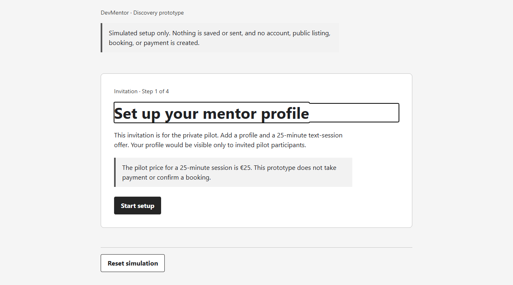
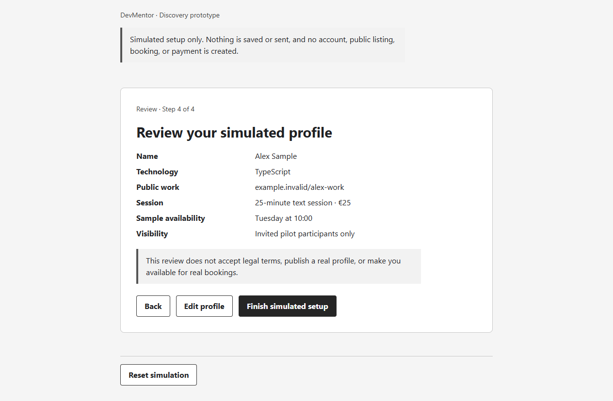
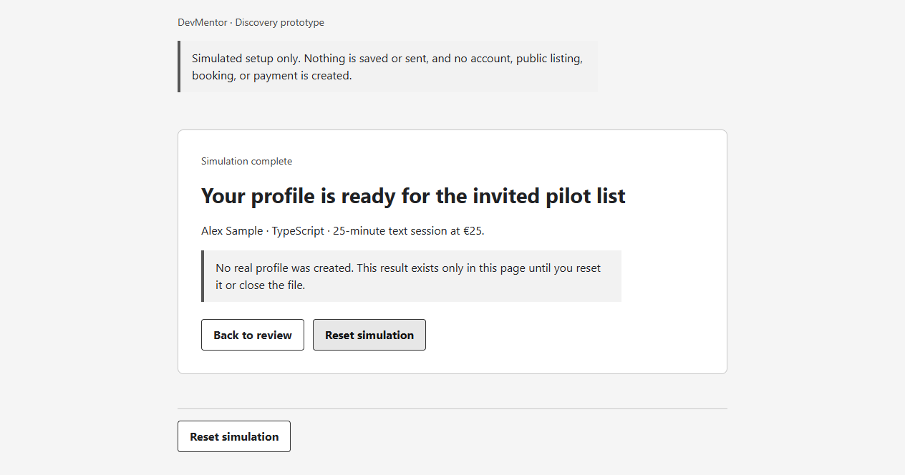

# 👋 DevMentor

### Praktyczna pomoc od doświadczonych programistów — przez tekst i we własnym tempie.

[Funkcje](#-co-możesz-zrobić) · [Getting Started](#-getting-started) · [Dokumentacja](docs/README.md)

DevMentor łączy osoby szukające pomocy technicznej z mentorami. Możesz znaleźć eksperta po technologii, umówić płatną sesję tekstową albo skorzystać z odpowiedzi przygotowanej na podstawie notatek mentora.

## ✨ Co możesz zrobić

- 🔎 **Znajdź mentora** — przeglądaj profile i technologie oraz sprawdź odnośniki do publicznej pracy.
- 💬 **Umów sesję tekstową** — wybierz dostępny termin, opisz problem i prowadź rozmowę z mentorem w aplikacji.
- 🗓️ **Zarządzaj dostępnością i rezerwacjami** — mentorzy publikują terminy, odpowiadają na prośby i prowadzą swoje sesje.
- 📝 **Zapisuj wiedzę** — mentorzy tworzą notatki, a wybrane materiały mogą posłużyć do przygotowania odpowiedzi Vault.
- 💡 **Korzystaj z Vault** — przeglądaj odpowiedzi oparte na wiedzy mentorów wraz z informacją o autorze i źródłach.
- 🛡️ **Korzystaj z przestrzeni dla uczestników pilota** — konta, role i narzędzia operatora wspierają zaproszenia, obsługę płatności i administrację.

## 🖼️ Zobacz prototyp

Poniższe zrzuty pochodzą z przebiegu prototypu onboardingu mentora. Pokazują symulację interfejsu, a nie działającą funkcję produkcyjnej aplikacji.

  
  
  

## 🚀 Getting Started

Wymagania i konfiguracja zależą od aplikacji w monorepo. Zacznij od [krótkiej instrukcji uruchomienia](docs/README.md#getting-started); pełny opis środowiska, pakietów i zmiennych znajdziesz w [dokumentacji technicznej](docs/README.md).

### Wdrożenie na Dokploy

Aplikację wdrożysz na Dokploy jako projekt **Docker Compose** z pliku `docker-compose.yml`. Wszystkie kroki — od konfiguracji sekretów i domeny po aktualizacje i kopie zapasowe — opisuje [instrukcja wdrożenia](docs/DEPLOYMENT.md).

## 📚 Dokumentacja

- [Dokumentacja projektu i przewodnik deweloperski](docs/README.md)
- [Pakiet aplikacji](packages/app/README.md)

---

🌱 DevMentor jest rozwijany iteracyjnie. Dostępność funkcji może zależeć od etapu pilota.
