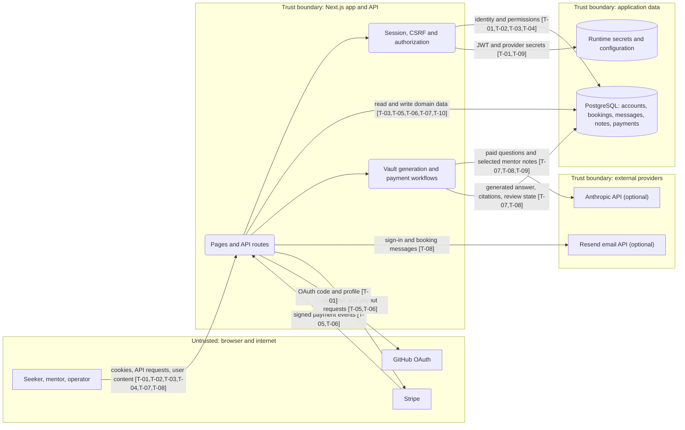

# Threat model: DevMentor

**Scope:** Implemented web application, API, PostgreSQL data, and configured external integrations  
**Last updated:** 2026-11-15  
**Owner:** Project owner (not identified in repository)

> **Access verification status (2026-11-15):** Three high-impact access/isolation threats were checked: T-03 cross-account messages, T-04 operator routes, and T-08 vault-answer isolation. In isolated `devmentor_qa` on port 5434, both accounts passed their positive controls for each boundary; cross-account reads and writes/actions returned 403/404; each relevant DB snapshot was unchanged. Detailed evidence cards and limitations: [access-boundaries-2026-11-15.md](access-boundaries-2026-11-15.md), with full synthetic transcript at `.ai/qa/access-audit-2026-11-15/api-results.json`. No access finding was confirmed in the tested cases. SAST/DAST coverage and limits: [report](sast-dast-2026-11-15.md).

DevMentor is an invitation-based mentoring marketplace with paid text sessions and mentor-note vault answers. Seekers, mentors, and configured operators use one Next.js application backed by PostgreSQL. The highest risks are cross-account access to private booking/note/payment data, operator or payment workflow abuse, and exposure or misuse of user content sent to AI and email providers.

## 1. What are we working on?

### System profile

| Application | Type | Stack | Deployed as | Auth | Tenancy | AI |
| --- | --- | --- | --- | --- | --- | --- |
| DevMentor | Browser web app + HTTP API; modular monolith | Next.js 16, React 19, TypeScript, Awilix, MikroORM, PostgreSQL | One Next.js app; deployment platform is not established | HS256 JWT in `httpOnly`, `SameSite=Lax` cookie; GitHub OAuth and magic-link flows are implemented | No tenant model; users and roles share a database. Role and record ownership checks are service/route enforced | Optional Anthropic generation of paid vault answers from seeker questions and selected published mentor notes; mock adapter is default |

**Architecture:** `app → core → db`; UI is consumed by the app. No separately deployed worker is identified; vault generation is invoked from the payment webhook's background callback.  
**Data stores:** PostgreSQL. Runtime configuration and secrets come from environment variables.  
**External systems:** GitHub OAuth, Stripe payments/payouts, Anthropic AI, Resend email; mock payment/AI and console mail adapters also exist.  
**Authorization:** Seeker, mentor, and operator checks plus record ownership/participant checks. Operator identity is configured by user IDs. No tenant isolation is claimed.

### Assets

- Account identities, session and one-time login tokens, operator privileges, and provider credentials.
- Booking questions and messages, private mentor session notes, published notes, generated answers and citations.
- Payment, refund, payout, terms acceptance, and ledger records.
- Integrity and availability of booking, payment, review, retention, and operator workflows.

### Actors

| Actor | Access | Motivation |
| --- | --- | --- |
| Anonymous internet user | Public pages and unauthenticated endpoints | Abuse signup, login, checkout, or resource availability |
| Seeker | Own account, bookings, questions, purchased answers | Access another user's records or manipulate payment/workflow state |
| Mentor | Own profile, availability, notes, and assigned bookings | Access another mentor's private data or influence publication/payout state |
| Operator | Configured operator endpoints | Mistaken or compromised account can approve/refund/pay out or access broad data |
| Untrusted user content | Questions, messages, mentor-written notes | Stored content may contain malicious instructions or unsafe output |
| Compromised/misconfigured provider or dependency | Data sent to or returned from integrations | Exfiltrate content, forge/alter events, or disrupt service |

### Entry points

| Application | Entry point | Auth required | Notes |
| --- | --- | --- | --- |
| Web/API | `/api/auth/*` | No | Password, magic-link and GitHub flows; demo GitHub persona mapping is also implemented |
| Web/API | `/api/bookings/*`, `/api/vault-answers/*`, `/api/messages/*`, `/api/session-notes/*` | Usually yes | User content, paid workflows, and private records; public booking/vault creation paths exist |
| Web/API | `/api/operator/*` | Yes, configured operator | Approvals, refunds, payouts, retention, terms, metrics, and user administration |
| Web/API | `/api/payments/webhook` | Provider signature | External callback that mutates payment state and can start vault generation |
| Web/API | `/api/mentors/*`, `/api/articles/*`, `/api/terms/*` | Mixed | Public reads and authenticated writes; per-route/service rules apply |
| Integrations | GitHub, Stripe, Anthropic, Resend | Provider credentials/signatures | OAuth callback, webhook, model prompt/output, and outbound mail boundaries |

### Data flow and trust boundaries

Boundaries: browser↔app; app↔database/configuration; app↔GitHub/Stripe/Anthropic/Resend; untrusted question/note text↔model; provider callback↔payment state. Diagram source: [threat-model.mmd](threat-model.mmd).

### AI components

| Component | Untrusted input | Sensitive data / systems | Changes state or sends externally | Rule of Two verdict |
| --- | --- | --- | --- | --- |
| Vault answer generator (Anthropic, optional) | Yes: seeker question and mentor-authored notes | Yes: questions, notes, names and citations are sent to provider | Yes: output is persisted; it may release directly when preview is disabled, or be released after mentor review | **3/3**. The pilot's mentor preview is a useful gate, but direct release is configurable. Keep preview/approval mandatory for live generation, isolate provider context, and test prompt injection and output/citation validation. |

### Assumptions and open questions

- [ ] Deployment topology, TLS/reverse-proxy configuration, production database controls/backups, and secret-manager use are not established by repository code.
- [ ] The product brief describes a real-money pilot, while `.env.example` defaults to mock payment/AI and disables live flags. Confirm deployed values and ensure demo accounts/credentials and mock endpoints cannot be enabled in a public environment.
- [ ] Operator authentication is based on configured user IDs; confirm operational approval, account recovery, and audit/alerting processes outside the code.
- [ ] AI provider retention/data-processing terms and the exact scope of notes sent for generation need owner confirmation.
- [ ] No separate worker or scheduled runtime is evident; verify how retention and vault expiry tasks are triggered in the deployed environment.

## 2. What can go wrong?

| ID | Threat | STRIDE | Where | L | I | Response | Control today | How we verify | OWASP / CWE |
| --- | --- | --- | --- | --- | --- | --- | --- | --- | --- |
| T-01 | Attacker obtains a session through weak/deployed demo credentials, OAuth account mapping, or stolen signing secret, then acts as a seeker, mentor, or operator. | S, E | Auth routes; `security/session.ts`; environment configuration | M | H | Mitigate: keep demo mappings disabled outside isolated environments, protect/rotate secrets, review OAuth identity mapping and operator IDs. | HS256, 24-hour expiry, `httpOnly`/`SameSite=Lax`; OAuth state nonce; role-specific verified-email checks; deployment state unknown. | Inspect production configuration and seed behavior; test invalid OAuth state, unverified email, missing invitation, disabled demo mapping, and role boundaries. | A07:2025, CWE-287 |
| T-02 | Cross-site mutation uses a victim's cookie to create or alter bookings, notes, profile, or operator state. | T, E | All mutating `/api/*` routes; `security/csrf.ts` | L | H | Mitigate: retain header, origin, and cookie protections on every mutation; reject absent/malformed Origin according to deployment policy. | `assertCsrfSafe` requires `x-requested-with` and checks supplied Origin; `SameSite=Lax`. Coverage must be checked route-wide. | DAST/manual browser test: cross-site form/fetch mutation and missing header against each mutation class; verify no state change. | A01:2025, CWE-352 |
| T-03 | One seeker or mentor reads/changes another user's booking, message, note, or profile by changing an object ID or role-specific route. | I, T, E | Booking, message, note, session-note, mentor and vault APIs/services | M | H | Mitigate: scope every query/mutation to session identity and participant/role; return deny-by-default responses. | `assertOwns`, `assertParticipant`, `requireOperator` and service checks exist; exhaustive route coverage is not proven by this model. | Two-account integration/DAST matrix: swap IDs for reads, edits, deletes, preview, and payment reconciliation across seeker/mentor/operator roles. | A01:2025, API1:2023, CWE-639 |
| T-04 | Non-operator reaches approvals, refunds, payouts, retention, or user administration by route access or a role-check gap. | E, T | `/api/operator/*`; `http/auth.ts`; operator services | M | H | Mitigate: enforce operator check on every method and recheck authorization inside sensitive service operations. | `requireOperator` appears on operator route; `OPERATOR_USER_IDS` configuration; no separate MFA evidence. | For each operator route, call as anonymous, seeker, mentor, and operator; assert denial/no side effects for first three and inspect audit trail for the latter. | A01:2025, API5:2023, CWE-862 |
| T-05 | Forged, replayed, or out-of-order payment events, or a compromised webhook secret, cause false paid/refunded state or duplicate credit. | S, T, R | `/api/payments/webhook`; payment/refund/ledger services | M | H | Mitigate: verify signatures on raw body, enforce idempotent terminal transitions and reconcile provider state for high-impact changes; alert on anomalous events. | Configured signature verification and status-transition/idempotency logic are implemented; deployment secret hygiene is unknown. | Integration tests with invalid signature, duplicate and out-of-order events, wrong environment/account, and amount/currency mismatch; verify one ledger effect. | API webhook risks, CWE-345 |
| T-06 | A user manipulates checkout amount, subject, payout target, or refund state to gain money or trigger unauthorized transfer. | T, E | Checkout, mock-payment, reconcile, operator refund/payout APIs | M | H | Mitigate: derive amounts/ownership server-side, bind provider metadata to stored records, restrict mock routes to isolated environments, require explicit operator authorization for refunds/payout batches. | Server-side price recomputation, ownership and operator guards, live-payment flags, Stripe adapter and mock adapter. Confirm all route paths and deployment flags. | Test tampered amount/subject/mentor IDs and cross-account checkout; confirm mock payment routes are unavailable in a production-like configuration; verify payout/refund audit records. | API1:2023, API5:2023, CWE-862 |
| T-07 | Prompt injection embedded in a question or mentor note makes the model produce unsupported, revealing, or harmful paid content or citations. | T, I, E | Vault question/note intake; `NoteSelector`; Anthropic adapter; generation/release task | H | H | Mitigate: treat all content as untrusted, minimize context, constrain/validate answer and citation IDs, require mentor approval for live publication, and provide refund/cancellation on validation failure. | Structured output schema, citation validation, bounded corpus, note consent/publication, reviewer workflow when enabled; provider receives question and selected notes. | Synthetic prompt-injection suite in isolated AI-enabled test environment; verify no cross-seeker identity/data, unsupported citation, or release before required approvals. | LLM01:2025, CWE-693 |
| T-08 | Private questions, notes, magic links, or booking details leak through provider requests, email delivery, logs, or over-broad generated output; a different seeker may read another seeker's vault answer by changing its ID. | I, E | Anthropic/Resend integrations, logger, `/api/vault-answers/[id]`, API DTOs | M | H | Mitigate: minimize and classify outbound data, restrict logs, scope answer lookup to session seeker/assigned reviewer, confirm provider terms/retention, and review DTOs/email templates. | `VaultAnswerService.get()` checks seeker ownership; `getParticipant()` permits the assigned mentor through review lookup. Cross-seeker API behavior requires live verification. | Inspect provider payloads/retention; two-seeker API matrix (both positive controls, cross-ID GET and write/action attempt, DB before/after); scan logs/responses for private data. | A01:2025, API1:2023, A02:2025, LLM06:2025, CWE-639, CWE-200 |
| T-09 | Public or authenticated callers exhaust login, magic-link, AI, booking, or database capacity; process-local limits are bypassed by multiple app instances. | D | Auth and resource-intensive API routes; `security/rate-limit.ts` | H | M | Mitigate: use shared limits for deployed replicas; rate-limit expensive generation/checkout and public endpoints; bound request sizes/timeouts and monitor. | In-memory limiters cover login/register/magic-link; generation attempts and corpus size are bounded; shared store and broad endpoint throttling are not evident. | Load/security test in isolated environment with bounded traffic; verify limits across two app instances and cost-sensitive generation/checkout routes. | A04:2025, API4:2023, CWE-770 |
| T-10 | Malformed or attacker-controlled input changes persisted fields, injects stored script content, or exposes sensitive fields through public DTOs. | T, I, E | Public profile/article/note and booking APIs; validators and DTO serializers | M | M | Mitigate: keep explicit schemas and output DTOs; review rendered user content and URL protocols; encode at output boundaries. | Zod validation and DTO patterns are standard; email HTML escapes user content. Confirm all public rendering paths and link validators. | SAST plus review of all write schemas and serializers; submit markup/unsafe URL strings in synthetic content and inspect rendered pages and API output. | A03:2025, CWE-79 |
| T-11 | Sensitive actions cannot be reliably attributed, or errors reveal internal details useful for account/provider attacks. | R, I | Auth/payment/operator workflows; `apiHandler`; logger | M | M | Mitigate: record security-relevant actor, subject, result, and correlation ID without secrets; alert on operator/payment anomalies. | Generic 500 envelope and structured logger; no comprehensive immutable audit trail or alerting is confirmed. | Review logs for operator approval/refund/payout, auth failures, and webhook transitions; verify secrets and full tokens are absent and actor/subject are reconstructable. | A09:2025, CWE-778 |

STRIDE coverage: session/OAuth (S), authenticated API and content (T/I/E), mutating cookie routes (T/E), privileged operations (E/T), payments (S/T/R), providers and storage (I), and public/resource-intensive endpoints (D) are covered above. No dedicated repudiation finding is applicable to ordinary public reads; sensitive operator/payment attribution is addressed by T-11.

## 3. Test scope

| Method | What to try | Threats |
| --- | --- | --- |
| Integration tests | Invalid OAuth state/identity; all webhook signature, replay, order and amount cases; tampered prices/subjects; production-mode mock-route gating. | T-01, T-05, T-06 |
| SAST and code review | Enumerate every mutation for CSRF; every object lookup for ownership/role scope; inspect schemas, DTOs, public rendering and logs. | T-02, T-03, T-04, T-10, T-11 |
| DAST, synthetic accounts | Anonymous, seeker, mentor and operator access matrix; cross-account ID changes; cross-site mutation; bounded rate tests across app instances. | T-02, T-03, T-04, T-09 |
| Manual provider/config review | Confirm demo and mock features are disabled in deployment; inspect outbound AI/email data and configured provider retention; review operator audit events. | T-01, T-06, T-08, T-11 |
| Prompt injection, synthetic content | Try hostile instructions in question and mentor notes; check answer grounding, citation membership, privacy, required review, release and refund behavior. | T-07, T-08 |

**Out of scope:** Provider internal security, volumetric denial of service, social engineering, host/cloud account compromise, legal/privacy compliance assessment, and production testing.

**Rules of engagement:** Run only in an isolated non-production environment with synthetic data and seeded seeker, mentor, and operator accounts. Use Stripe test mode and provider test credentials or mocks. Do not send real user notes/questions, use live payment credentials, or probe shared development/staging services without a separately agreed scope.

**Access-control evidence rule:** For each of the three highest-impact access/isolation threats, use two independently authenticated synthetic accounts. First prove each account can access its own control resource (HTTP success for both); then attempt cross-account read and write/action with the other account's ID; capture HTTP status and response; compare the relevant persisted rows before and after. A denial without proving the attacking account's login and own-resource access is inconclusive. Record each boundary as its own evidence card with base/target commit, environment, seed, account, timestamp, request, response, DB state, limitations, and decision owner. A read-only DAST spider is not a substitute.

## 4. Did we do a good job?

- [x] Every identified deployable application has a profile; libraries are covered through their app consumer.
- [x] Entry points and boundary crossings were considered across all STRIDE categories; non-applicable areas are stated above.
- [x] AI component has a Rule of Two verdict.
- [x] Every High threat includes mitigation and a concrete verification step.
- [x] Cross-account and cross-role threats are included; the system has no tenant model.
- [x] Threat IDs annotate the diagram flows.
- [x] Deployment unknowns are marked as assumptions.
- [x] The document contains no attack payloads or exploit instructions.
- [x] Out-of-scope and engagement boundaries are explicit.
- [x] Three fresh two-account API boundary checks completed with positive controls, read, write/action, and DB before/after snapshots (see evidence cards).
- [x] Evidence-card requirement added for each independently tested access boundary.

## Changelog

- 2026-11-15: Initial model based on repository docs and code review.
- 2026-11-15: Selected T-03, T-04, and T-08 for access-isolation verification; documented the two-account/API/state evidence rule and current environment limitation.
- 2026-11-15: Completed isolated API checks for T-03, T-04, and T-08; both positive controls per boundary succeeded, cross-account attempts were denied, and DB snapshots were unchanged.
